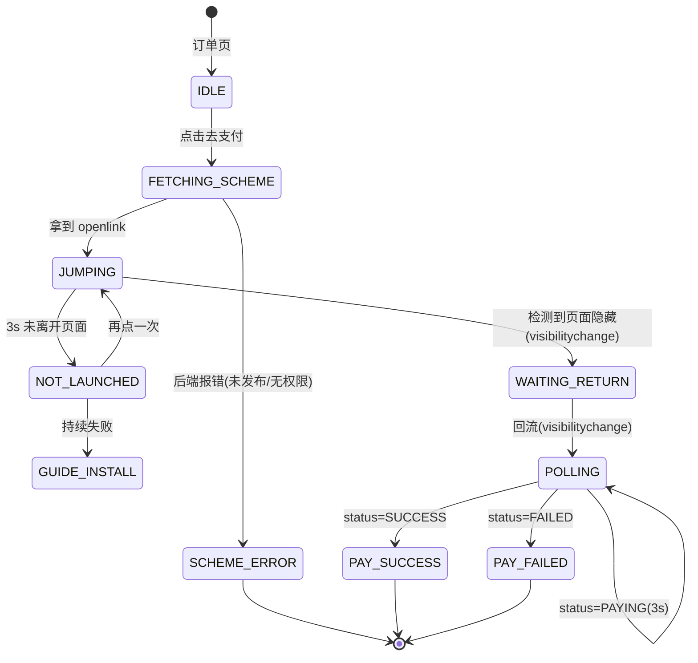

# 前端开发文档：外部 H5 拉起小程序收银台支付

> 范围：**外部浏览器 H5 → URL Scheme 拉起商户自己的微信小程序 → 小程序内跳通联收银台完成微信支付 → 结果回流 H5**
> 前端：H5(Vue3 + Vite) + 原生微信小程序
> 配套：`开发文档-通联收银宝微信支付收银台.md`（支付通道层，本文不重复其签名/通知细节）
> 版本：v1.0 / 2026-11-17

---

## 1. 需求与范围

### 1.1 业务链路

```
用户在外部浏览器(Safari/Chrome/其他App内嵌)打开 H5 商城
   └─ 点击"去支付"
        └─ H5 向后端要 Scheme 码 → 跳转 weixin://...
             └─ 拉起商户小程序支付页(pages/pay/pay?orderNo=xxx)
                  └─ 小程序向后端要收银台参数 → wx.navigateToMiniProgram 跳通联收银台
                       └─ 用户支付 → 返回小程序 → onShow 处理结果
                            └─ 用户切回浏览器 → H5 轮询后端得到终态
```

### 1.2 范围边界

| 在范围内 | 明确不在范围内 |
|---|---|
| 外部浏览器 H5 的 Scheme 拉起、回流轮询、失败引导 | 微信内 H5（`wx-open-launch-weapp` 开放标签方案，见 §4.7 作为兼容分支） |
| 商户小程序支付页（接参、跳收银台、收结果） | 通联通道签名、异步通知、退款（见配套文档 §5） |
| 前后端接口契约 | 商务进件、商户认证 |

### 1.3 关键技术结论（先读这个）

| # | 结论 | 依据 |
|---|---|---|
| 1 | Scheme 由**后端**生成 | `generatescheme` 需 `access_token`（依赖 AppSecret），官方明确**服务端调用，前端不可调** |
| 2 | 只能跳**已发布**的小程序 | 未发布报 `85079`；体验版/开发版需 `env_version=trial/develop`（仅微信外生效） |
| 3 | 小程序必须为**国内非个人主体** | 个人主体报 `40002` 无权限 |
| 4 | `path` 与 `query` 分开传 | `path` 不可携带 query；`query` 最大 1024 字符、仅支持数字/英文/`!#$&'()*+,/:;=?@-._~` |
| 5 | 有效期 1 分钟 ~ 30 天 | `85401`；支付场景建议与订单支付有效期对齐（如 1 小时） |
| 6 | **每单一条 Scheme，幂等复用** | 生成上限 50 万/天（Scheme+URLLink 合计）、100 次/秒；同一条 Scheme 2023-12 起已支持多用户打开，重试点击直接复用 |
| 7 | 跳转必须由**用户手势**触发 | 官方注明"部分浏览器会限制网页直接跳转"；严禁 `setTimeout`/`onload` 自动跳 |
| 8 | 打开结果无法同步获知 | Scheme 跳转无回调，用 `visibilitychange` 检测是否真的离开页面，未离开则引导 |
| 9 | H5 拿到的任何结果都只是 UI | 终态只认后端 `/api/pay/query` |

---

## 2. 交互流程与状态

### 2.1 端到端时序

```mermaid
sequenceDiagram
  autonumber
  participant U as 用户
  participant H5 as 外部浏览器 H5
  participant BE as 商户后端
  participant MP as 商户小程序
  participant CW as 通联收银台小程序
  participant WX as 微信API
  participant TL as 通联收银宝

  U->>H5: 订单页点击"去支付"(手势)
  H5->>BE: POST /api/pay/h5/scheme {orderNo}
  BE->>WX: POST /wxa/generatescheme (access_token)
  WX-->>BE: openlink
  BE->>BE: scheme 与支付单绑定落库(幂等)
  BE-->>H5: { openlink, expireAt }
  H5->>WX: location.href = openlink
  WX-->>U: 系统弹框"打开小程序?"
  U->>MP: 确认打开 → 支付页 onLoad(query.orderNo)
  MP->>BE: POST /api/pay/cashier/params {orderNo}
  BE-->>MP: extraData(已加签全字符串) + cashierAppId + halfScreenEnabled
  MP->>CW: navigateToMiniProgram / openEmbeddedMiniProgram
  CW->>TL: 支付
  U->>MP: 返回商户小程序
  MP->>MP: onShow: scene==1038 判定
  alt extraData 有值
    MP->>BE: POST /api/pay/query (更新UI)
  else extraData 为空(物理返回键)
    MP->>BE: POST /api/pay/query (必须主动查询)
  end
  U->>H5: 切回浏览器
  H5->>H5: visibilitychange 触发轮询
  H5->>BE: POST /api/pay/query
  BE-->>H5: { status: SUCCESS }
  BE-)>TL: (异步) POST notify_url → 订单终态
```

### 2.2 前端状态机



---

## 3. 环境与前置条件（开发前逐项确认）

| # | 项 | 归属 | 检查方式 |
|---|---|---|---|
| 1 | 小程序为**国内非个人主体**且**已有线上发布版本** | 产品 | MP 后台查看；未发布则 Scheme 全部报错 |
| 2 | 小程序 `request 合法域名` 含支付后端域名 `https://pay.example.com` | 后端/运维 | MP 后台-开发管理-服务器域名 |
| 3 | H5 域名 HTTPS、证书有效；后端已为 H5 域名开 CORS | 后端 | `curl -i -X OPTIONS` |
| 4 | 微信 AppID + AppSecret 由后端托管（access_token 有中控服务） | 后端 | 不要把 AppSecret 给前端 |
| 5 | 通联侧：商户号开通网上收银-微信支付、渠道认证完成 | 商务 | 见配套文档 §3 |
| 6 | 小程序支付页路径固定：`/pages/pay/pay`，入参仅 `orderNo` 与可选 `source` | 前端 | 路径一旦发布不可随意改，Scheme 的 `path` 是写死进后端配置的 |
| 7 | `orderNo` 字符集符合 Scheme query 白名单 | 后端 | 订单号规则建议 `B+日期+序号`，只含数字与英文 |

---

## 4. H5 端开发（Vue3）

### 4.1 目录与页面

```
src/
├── views/
│   ├── OrderDetail.vue        # 下单/订单详情页，"去支付"入口
│   └── PayResult.vue          # 支付结果页（轮询宿主）
├── composables/
│   ├── usePayJump.ts          # Scheme 获取 + 跳转 + 拉起检测
│   └── usePayResult.ts        # 回流轮询
├── api/pay.ts                 # 后端契约封装
└── utils/env.ts               # UA/环境检测
```

### 4.2 环境检测

```ts
// src/utils/env.ts
export const isWeChatBrowser = () => /MicroMessenger/i.test(navigator.userAgent);
export const isIOS = () => /iphone|ipad|ipod/i.test(navigator.userAgent);
```

环境 → 行为映射：

| 环境 | 行为 |
|---|---|
| 微信外浏览器 | **主流程**：Scheme 拉起 |
| 微信内置浏览器 | Scheme 不可用 → 提示"点击右上角…在浏览器中打开"，或按 §4.7 开放标签扩展 |
| 企业微信/其他特殊 WebView | 同微信内置处理，预留文案配置位 |

### 4.3 获取 Scheme 并跳转

```ts
// src/api/pay.ts
import http from './http';

/** 获取 Scheme 码（后端幂等：同一订单返回同一条） */
export const fetchScheme = (orderNo: string) =>
  http.post<{ openlink: string; expireAt: number }>('/api/pay/h5/scheme', { orderNo });

export const queryPayResult = (orderNo: string) =>
  http.post<{ status: 'PAYING' | 'SUCCESS' | 'FAILED' | 'CLOSED';
              amountFen?: number; payTime?: string; errmsg?: string }>(
    '/api/pay/query', { orderNo });
```

```ts
// src/composables/usePayJump.ts
import { ref } from 'vue';
import { fetchScheme } from '@/api/pay';
import { isWeChatBrowser } from '@/utils/env';

export function usePayJump() {
  const state = ref<'IDLE' | 'FETCHING' | 'JUMPING' | 'NOT_LAUNCHED' | 'GUIDE'>('IDLE');

  /** 必须绑定在用户点击事件里：部分浏览器拦截非手势跳转 */
  async function goPay(orderNo: string) {
    if (isWeChatBrowser()) {
      // 微信内不支持 scheme，见 4.7
      state.value = 'GUIDE';
      return;
    }
    state.value = 'FETCHING';
    try {
      const { openlink, expireAt } = await fetchScheme(orderNo);
      state.value = 'JUMPING';
      // Android Chrome 需要 a 标签 click；iOS Safari 用 location.href 均可。
      // 禁止放 iframe / setTimeout 中执行。
      const a = document.createElement('a');
      a.href = openlink;
      document.body.appendChild(a);
      a.click();
      a.remove();
      detectLaunched(orderNo);          // 拉起结果检测，见 4.4
    } catch (e: any) {
      state.value = 'NOT_LAUNCHED';
      // 映射后端错误码，见 §7 错误码表
      showTip(e?.code ?? 'SCHEME_ERROR');
    }
  }

  return { state, goPay };
}
```

### 4.4 拉起结果检测与引导

Scheme 跳转**没有任何同步回调**。官方注意事项：跳转微信时可能弹系统确认框，用户选择不跳转则打不开小程序——前端必须兜底。

```ts
// src/composables/usePayJump.ts（续）
function detectLaunched(orderNo: string) {
  let launched = false;
  const onHide = () => { launched = true; };
  document.addEventListener('visibilitychange', onHide);
  window.addEventListener('pagehide', onHide);

  setTimeout(() => {
    document.removeEventListener('visibilitychange', onHide);
    window.removeEventListener('pagehide', onHide);
    if (!launched && state.value === 'JUMPING') {
      state.value = 'NOT_LAUNCHED';
      // 展示：① 系统弹框是否被点了"取消" ② 未安装微信的安装引导
      // 文案："若未跳转微信，请确认已安装微信并允许打开；支付完成后请返回本页查看结果"
    }
  }, 3000);
}
```

### 4.5 回流后轮询（终态只认后端）

```ts
// src/composables/usePayResult.ts
import { ref, onMounted, onUnmounted } from 'vue';
import { queryPayResult } from '@/api/pay';

export function usePayResult(orderNo: Ref<string>, maxMs = 15 * 60 * 1000) {
  const status = ref<'PAYING' | 'SUCCESS' | 'FAILED' | 'CLOSED'>('PAYING');
  const deadline = Date.now() + maxMs;
  let timer: number | undefined;
  let polling = false;

  async function poll() {
    if (polling || status.value !== 'PAYING') return;
    polling = true;
    try {
      const r = await queryPayResult(orderNo.value);
      status.value = r.status;
    } finally { polling = false; }
  }

  function schedule() {
    if (timer) return;
    timer = window.setInterval(poll, 3000);
  }

  onMounted(() => {
    schedule();                                          // 常态轮询
    document.addEventListener('visibilitychange', () => {
      if (document.visibilityState === 'visible') poll(); // 切回浏览器立即查一次
    });
    window.addEventListener('focus', poll);
  });
  onUnmounted(() => timer && clearInterval(timer));

  return { status };
}
```

规则：

- 轮询间隔 **3s**，后端对同一订单做频控合并（§6.3），前端无需担心被限流。
- 达到 `maxMs`（默认 15 分钟）仍未终态 → 停止轮询，展示"支付确认中，稍后在订单列表查看"，订单列表页继续兜底。
- `SUCCESS/FAILED` 为终态后**停止**轮询；`CLOSED` 展示重新支付入口。

### 4.6 页面 UX 约定

| 页面 | 必备元素 |
|---|---|
| 订单页 | "去支付"按钮（点击后 300ms 内必须发起请求，避免用户手势时效失效） |
| 跳转中 | "正在打开微信…" loading + 取消按钮 |
| 未拉起 | 两种引导：微信未安装 → 引导下载；弹框被拒 → "请重试并选择'打开'" |
| 等待支付 | "支付完成后请返回浏览器查看结果" + 手动"刷新结果"按钮（防 visibilitychange 失效的机型） |
| 结果页 | 成功/失败/超时三态 + 重新支付入口 |

### 4.7 微信内打开 H5 的兼容（可选扩展）

微信内置浏览器**不支持** Scheme。范围外但必须优雅降级：

1. **最小实现**：检测到微信 UA → 蒙层提示"请在浏览器中打开后完成支付"。
2. **扩展实现（后续迭代）**：公众号网页 + `wx-open-launch-weapp` 开放标签拉起小程序；需要**已认证服务号 + JS 接口安全域名**，签名由后端提供。此分支方案见配套文档 §6.1 方式 A。

---

## 5. 小程序端开发（原生）

### 5.1 支付页接收 Scheme 进入

Scheme 落地路径 `/pages/pay/pay`，微信把 `query` 转成 `onLoad(options)` 参数。

```js
// pages/pay/pay.js
import { jumpToCashier, queryResult } from '../../utils/allinpay';

Page({
  data: {
    orderNo: '', status: 'INIT', fromH5: false,
    cashierAppId: '', halfScreenEnabled: false,
  },

  onLoad(options) {
    // Scheme 进入时 options = { orderNo: 'B202611170001', source: 'h5' }
    this.setData({ orderNo: options.orderNo || '', fromH5: options.source === 'h5' });
    this.prepare();
  },

  async prepare() {
    try {
      const p = await request.post('/api/pay/cashier/params', { orderNo: this.data.orderNo });
      // p = { extraData, cashierAppId, halfScreenEnabled, expireAt }
      this.setData({
        extraData: p.extraData,
        cashierAppId: p.cashierAppId,        // 收银台 appId 由后端下发，前端不硬编码
        halfScreenEnabled: p.halfScreenEnabled,
      });
      if (this.data.fromH5) {
        // H5 来源提示：支付完成后需切回浏览器查看结果
        wx.showToast({ title: '支付完成后请返回浏览器查看结果', icon: 'none' });
      }
    } catch (e) {
      // PAY_ORDER_EXPIRED / PAY_ORDER_NOT_PAYABLE → 引导返回
    }
  },

  onTapPay() { this.jump(); },

  jump() {
    jumpToCashier(this.data).catch(() => {
      // 跳转确认弹窗点"取消"，或未申请半屏却调 openEmbeddedMiniProgram
      wx.showToast({ title: '支付已取消', icon: 'none' });
      this.queryResult('JUMP_FAIL');
    });
  },
});
```

### 5.2 跳转通联收银台

```js
// utils/allinpay.js
const MP_MIN_SDK = '2.26.2';   // 半屏 openEmbeddedMiniProgram 最低基础库

function compareVersion(v1, v2) {
  const a = v1.split('.'), b = v2.split('.');
  const len = Math.max(a.length, b.length);
  while (a.length < len) a.push('0');
  while (b.length < len) b.push('0');
  for (let i = 0; i < len; i++) {
    const x = parseInt(a[i], 10), y = parseInt(b[i], 10);
    if (x > y) return 1;
    if (x < y) return -1;
  }
  return 0;
}

/**
 * extraData 所有参数值必须是字符串（通联要求）
 * 后端已保证全字符串，此处兜底再转一次
 */
function toStrData(params) {
  const out = {};
  Object.keys(params || {}).forEach(k => {
    if (params[k] !== null && params[k] !== undefined) out[k] = String(params[k]);
  });
  return out;
}

function jumpToCashier(pageData) {
  const extraData = toStrData(pageData.extraData);
  const appId = pageData.cashierAppId;                    // wxef277996acc166c3
  const sdk = wx.getAppBaseInfo().SDKVersion;

  return new Promise((resolve, reject) => {
    const opts = { appId, extraData, envVersion: 'release' };
    if (pageData.halfScreenEnabled && compareVersion(sdk, MP_MIN_SDK) >= 0) {
      wx.openEmbeddedMiniProgram({ ...opts, success: resolve, fail: reject });
    } else {
      wx.navigateToMiniProgram({ ...opts, success: resolve, fail: reject });
    }
  });
}
```

> `halfScreenEnabled` 对应通联**半屏小程序申请**开关：未申请的一律走 `navigateToMiniProgram`（需求原文明确：没有申请半屏调用不需要做判断，直接 `wx.navigateToMiniProgram`）。

### 5.3 onShow 接收支付结果

```js
// pages/pay/pay.js（续）
onShow() {
  const options = wx.getEnterOptionsSync();
  // scene 比较用字符串；必须同时校验来源 appId，防止其他小程序返回被误判
  if (options.scene === '1038' && options.referrerInfo?.appId === this.data.cashierAppId) {
    const extraData = options.referrerInfo.extraData;
    if (!extraData) {
      // 物理返回键 / 半屏右上角关闭：微信特性，代码无法拿到结果 → 必须主动查询
      this.queryResult('NO_CALLBACK');
      return;
    }
    if (extraData.code === 'success')      this.queryResult('FRONT_SUCCESS');
    else if (extraData.code === 'cancel')  this.setStatus('CANCEL');
    else                                   this.setStatus('FAIL', extraData.errmsg);
  }
},

async queryResult(source) {
  const r = await request.post('/api/pay/query', { orderNo: this.data.orderNo, source });
  this.setStatus(r.status, r.errmsg);
  if (r.status === 'PAYING') setTimeout(() => this.queryResult('POLL'), 3000);
}
```

### 5.4 发布与版本注意

| 项 | 要求 |
|---|---|
| Scheme `env_version` | 生产固定 `release`；联调用 `trial`/`develop`（仅微信外生效，正好覆盖本场景联调） |
| 页面存在性 | `/pages/pay/pay` 必须是**已发布版本中存在**的页面，否则 Scheme 打开后报页面不存在 |
| 收银台 appId | 从后端下发取值（`cashierAppId`），禁止前端写死——测试/生产可切换 |
| 小程序 request 域名 | `pay.example.com` 必须提前加白，H5 跳进小程序后第一件事就是调后端 |
| 基础库 | 半屏需 ≥ 2.26.2 且已申请；否则 `navigateToMiniProgram` |

---

## 6. 后端需要提供什么（给前端的交付清单）

### 6.1 接口契约（3 个）

#### ① `POST /api/pay/h5/scheme` — 获取 Scheme 码

```
请求  { "orderNo": "B202611170001" }
响应 200 { "openlink": "weixin://dl/business/?t=XXXXXXXX",
           "expireAt": 1732291200 }        // unix 秒，前端仅展示用
```

后端实现要求：

| 要求 | 说明 |
|---|---|
| 调用微信 `POST https://api.weixin.qq.com/wxa/generatescheme?access_token=...` | 服务端调用；`access_token` 用稳定版接口中控托管 |
| 请求体 | `{"jump_wxa":{"path":"/pages/pay/pay","query":"orderNo=B202611170001&source=h5","env_version":"release"},"is_expire":true,"expire_type":0,"expire_time":<now+有效期>}` |
| `path` 不可携带 query；`query` 仅含白名单字符（§1.3-4） | `orderNo` 规则需符合；`source=h5` 用于小程序侧区分来源提示 |
| **幂等**：同一 `orderNo` 复用同一条 Scheme 直到过期 | 绑定支付单落库；重试点击、刷新页面都返回同一条。生成上限 50 万/天、100 次/秒 |
| 有效期与订单支付有效期对齐（建议 1 小时，上限 30 天） | `expire_time` 取值 > 1min 且 < 30d，否则 `85401` |
| 错误码透传 | 见 §6.4 |
| 鉴权 | H5 侧需登录态/防重放（Scheme 本身无敏感性，但接口要防刷） |

#### ② `POST /api/pay/cashier/params` — 收银台跳转参数

```
请求  { "orderNo": "B202611170001" }
响应 200 { "extraData": {
              "cusid":"990581007426001", "appid":"00000051", "innerappid":"00000051",
              "orgid":"", "version":"12", "reqsn":"P2026111700000001", "trxamt":"1",
              "notify_url":"https://pay.example.com/api/pay/allinpay/notify",
              "body":"商品标题", "remark":"P2026111700000001", "validtime":"60",
              "limit_pay":"no_credit", "paytype":"W06", "isdirectpay":"1",
              "randomstr":"...", "signtype":"RSA", "sign":"..." },
           "cashierAppId": "wxef277996acc166c3",
           "halfScreenEnabled": false,
           "expireAt": 1732291200 }
```

| 要求 | 说明 |
|---|---|
| `extraData` **全字段字符串** | 通联要求前端 `extraData` 所有值为 String 类型；`sign` 由**商户私钥**在后端计算 |
| `cashierAppId` / `halfScreenEnabled` 由配置下发 | 前端零硬编码；半屏开关随通联侧申请状态切换 |
| 幂等：同一订单复用同一 `reqsn` | 重复请求返回同一套参数；禁改 `reqsn` 重试（`3888` 流水号重复） |
| 校验订单可支付状态 | 已支付/已关闭返回 `PAY_ORDER_NOT_PAYABLE` 等 |
| 签名规则与字段表 | 见配套文档 §4、§5.2 |

#### ③ `POST /api/pay/query` — 支付结果查询（H5 与小程序共用）

```
请求  { "orderNo": "B202611170001", "source": "POLL|NO_CALLBACK|FRONT_SUCCESS|JUMP_FAIL" }
响应 200 { "status": "PAYING|SUCCESS|FAILED|CLOSED",
           "amountFen": 1, "payTime": "20261117103201", "errmsg": "" }
```

| 要求 | 说明 |
|---|---|
| 本地终态直接返回，非终态才透传通联 `POST /apiweb/tranx/query` | `reqsn`/`trxid` 二选一，同时拥有优先 `trxid` |
| **频控**：同一订单 1s 内合并结果（前端 3s 轮询 + 小程序轮询可能并发） | 防止打爆通联查询接口 |
| H5 与小程序共用，`source` 仅作埋点 | 帮助区分"前端有回调"与"物理返回键兜底" |
| `status` 映射 | 通联 `trxstatus=0000→SUCCESS`；`3xxx→FAILED`；`2000/2008/空→PAYING`；`1001 且过 validtime→CLOSED` |

#### （内部，不暴露给前端）`POST /api/pay/allinpay/notify`

通联异步通知入口。前端不需要关心，但后端上线前必须完成：公网可达、HTTPS、443 端口、无 query 参数、全量参数验签、应答纯文本 `success`（见配套文档 §5.3）。

### 6.2 配置与凭据（后端托管，前端不持有）

| 项 | 值/来源 | 给谁 |
|---|---|---|
| 商户小程序 AppID + AppSecret | MP 后台，后端托管 access_token | 仅后端 |
| Scheme 落地路径 `/pages/pay/pay` | 与小程序端约定一致，进配置 | 仅后端 |
| 通联 `cusid/appid/(orgid)/商户私钥/验签公钥` | 环境变量/KMS | 仅后端 |
| 通联收银台小程序 `wxef277996acc166c3` | 后端通过 `cashierAppId` 下发 | 前端（运行时取） |
| 半屏开关 | 后端配置下发 | 前端（运行时取） |
| `notify_url` | 后端生成进 `extraData` | 仅后端 |

### 6.3 非功能要求

| 项 | 要求 |
|---|---|
| CORS | 允许 H5 生产域名（外部浏览器直接 fetch，无同源） |
| HTTPS | 全链路；Scheme 接口/查询接口无需证书特殊配置 |
| 可用性 | `h5/scheme`、`cashier/params`、`query` 三个接口的可用性 = 支付可用性，需要监控与告警 |
| Scheme 生成失败降级 | 微信 `generatescheme` 故障时：返回明确错误码让前端引导重试；**不要**返回过期 Scheme |
| 日志 | `scheme` 生成记录（orderNo、openlink 指纹、expireAt）、query 调用与频控命中 |
| 对账兜底 | 通知丢失场景由补偿任务查询收敛（配套文档 §5.4），H5 轮询只是 UI 手段 |

### 6.4 错误码契约（前后端统一）

| code | HTTP | 场景 | 前端行为 |
|---|---|---|---|
| `ORDER_NOT_FOUND` | 404 | 订单号非法 | 提示联系客服 |
| `PAY_ORDER_NOT_PAYABLE` | 409 | 已支付/已关闭/已退款 | 跳订单状态页 |
| `PAY_ORDER_EXPIRED` | 410 | 超过支付有效期 | 提示重新下单 |
| `SCHEME_GENERATE_FAILED` | 502 | 微信生成失败(40001/44993/85079…) | 提示稍后重试；运营侧看日志 |
| `SCHEME_NO_PERMISSION` | 403 | `40002/85407` 个人主体/未开通 | 阻断 + 告警，属配置问题 |
| `SCHEME_MINI_NOT_RELEASED` | 409 | `85079` 小程序无线上版本 | 阻断 + 告警 |
| `RATE_LIMITED` | 429 | 频控 | 前端退避，不要立即重试 |
| `UNAUTHORIZED` | 401 | 登录态失效 | 跳登录 |
| `ALLINPAY_SIGN_VERIFY_FAIL` | 500 | 通联响应验签失败 | 提示稍后重试 + 告警 |
| `CHANNEL_ERROR` | 502 | 通联 `retcode=FAIL` | 透传 `errmsg` |

---

## 7. 边界场景与测试用例

| ID | 用例 | 预期 |
|---|---|---|
| F01 | 外部浏览器点击支付 → Scheme → 小程序 → 收银台 → 支付成功 | 全链路通，H5 回流轮询得 SUCCESS |
| F02 | 同一订单**重复点击**"去支付"/刷新页面再点 | 返回同一条 openlink；小程序侧同一 `reqsn` |
| F03 | Scheme 过期后再点击 | 后端重新生成新 Scheme（expireAt 展示正确） |
| F04 | 微信内打开 H5 | 蒙层提示浏览器打开，不出现 Scheme 报错 |
| F05 | 用户在系统弹框点"取消" | 3s 后 NOT_LAUNCHED 引导文案，可重试 |
| F06 | 未安装微信点支付 | NOT_LAUNCHED → 安装引导 |
| F07 | 非手势自动跳转（回归检查） | 确认代码无 setTimeout/location 自动跳，浏览器不拦截 |
| F08 | 支付成功后切回浏览器 | visibilitychange 立即触发查询，<1s 出结果 |
| F09 | 支付中途切回浏览器（未支付） | 轮询得 PAYING，继续轮询；用户回小程序可继续支付 |
| F10 | 物理返回键退出收银台 | 小程序 onShow 走 NO_CALLBACK 查询；H5 侧同样查到终态 |
| F11 | 小程序未发布新版（path 不存在） | Scheme 打开报页面不存在 → 联调前用 trial 验证 path |
| F12 | 通知丢失 | 后端补偿任务收敛，H5 轮询仍能拿到 SUCCESS |
| F13 | 并发轮询 | H5 3s 轮询 + 小程序轮询并发，后端频控合并，通联查询量可控 |
| F14 | 半屏开关关闭 | 全部走 navigateToMiniProgram |
| F15 | 基础库 < 2.26.2 | 自动降级 navigateToMiniProgram |
| F16 | iOS Safari / Android Chrome / 企业微信外链 | 3 端真机各跑 F01 |
| F17 | `orderNo` 含非法字符（构造） | 后端 400，不生成 Scheme |
| F18 | Scheme 接口被刷 | 频控/登录态生效，生成量监控不超 50 万/天 |

---

## 8. 联调顺序与上线核对

**联调顺序**（阻塞依赖自上而下）：

```
1. 后端 scheme/params/query 三接口 Mock 可用 + CORS/HTTPS 就绪
2. 小程序支付页接通 params/query（先不跳收银台）
3. trial 版小程序 + env_version=trial 跑通 F01（外部浏览器真机）
4. 通联测试环境(1 分钱)跑通收银台与通知
5. 生产小额(1 分)回归 F01/F08/F10
```

**上线核对**：

```
[ ] 小程序已有 release 版本，/pages/pay/pay 存在且 request 域名已配
[ ] 后端 env_version 配置为 release（联调值 trial 不要带上生产）
[ ] cashierAppId / halfScreenEnabled 为生产值
[ ] H5 生产域名 CORS、HTTPS 生效
[ ] F01/F02/F05/F08/F10 生产回归通过
[ ] Scheme 生成量、query 频控命中率监控已接
[ ] 收银台/查询接口告警阈值已配置
[ ] 回滚方案：H5 支付开关（关闭后隐藏"去支付"）
```

---

## 9. 参考资料

- [获取加密 scheme 码（generatescheme）](https://developers.weixin.qq.com/miniprogram/dev/server/API/qrcode-link/url-scheme/api_generatescheme.html)
- [获取 URL Scheme（使用说明/规则）](https://developers.weixin.qq.com/miniprogram/dev/framework/open-ability/url-scheme.html)
- [9.1 微信小程序收银台支付调用说明（通联）](https://prodoc.allinpay.com/doc/1067/)
- [小程序收银台支付参数（通联）](https://prodoc.allinpay.com/doc/1380/)
- [3. 统一查询 API（通联）](https://prodoc.allinpay.com/doc/2330/)
- [wx.navigateToMiniProgram](https://developers.weixin.qq.com/miniprogram/dev/api/navigate/wx.navigateToMiniProgram.html)
