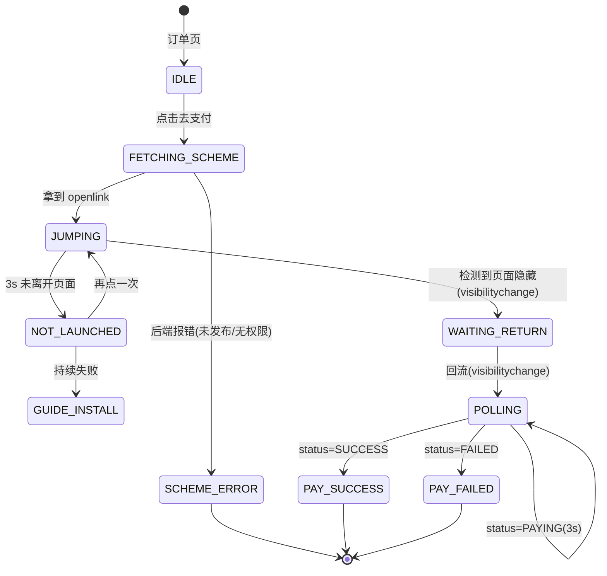

# 前端开发文档 V2：外部 H5 拉起小程序收银台支付

> 范围：**外部浏览器 H5 → URL Scheme 拉起商户自己的微信小程序 → 小程序内跳通联收银台完成微信支付 → 结果回流 H5**
> 前端：H5(Vue3 + Vite) + 原生微信小程序
> **V2 前提（已确认）**：商户小程序**从 0 到 1 全新开发**——需要先搭工程骨架、登录态、过审最小页面集，再在其中**新增 `pages/pay/pay` 支付页**
> 基线：`前端开发文档.md`（V1，假设小程序已存在）；V2 相对 V1 的增量集中在 §3、§5、§6.1-④、§7 F19~F26、§9、§10
> 配套：`开发文档-通联收银宝微信支付收银台.md`（支付通道层，本文不重复其签名/通知细节）
> 版本：v2.0 / 2026-11-17

---

## 1. 需求与范围

### 1.1 业务链路

```
【0→1 前置】注册小程序 + 微信认证 + 类目资质 → 搭工程骨架 + 登录 + 最小页面集 → 提审发布 release
运行时链路：
用户在外部浏览器(Safari/Chrome/其他App内嵌)打开 H5 商城
   └─ 点击"去支付"
        └─ H5 向后端要 Scheme 码 → 跳转 weixin://...
             └─ 拉起商户小程序支付页(pages/pay/pay?orderNo=xxx)
                  └─ 小程序向后端要收银台参数 → wx.navigateToMiniProgram 跳通联收银台
                       └─ 用户支付 → 返回小程序 → onShow 处理结果
                            └─ 用户切回浏览器 → H5 轮询后端得到终态
```

> V1 只画了运行时链路。V2 的第一行是新增的工程侧前置：它决定 H5 的支付按钮什么时候真的能用。

### 1.2 范围边界

| 在范围内 | 明确不在范围内 |
|---|---|
| 外部浏览器 H5 的 Scheme 拉起、回流轮询、失败引导 | 微信内 H5（`wx-open-launch-weapp` 开放标签方案，见 §4.7 作为兼容分支） |
| **小程序工程从 0 到 1**：目录结构、环境配置、登录态、请求封装（§5.1~§5.3） | 小程序首页/商城/会员等业务功能的完整实现（只做"过审最小页面集"，见 §5.3） |
| **新增支付页** `pages/pay/pay`：接参、跳收银台、收结果（§5.4~§5.6） | 小程序注册/认证/提审的操作执行（客户方管理员完成，本文给清单：§5.7、§9.1） |
| 前后端接口契约（含小程序登录，§6） | 通联通道签名、异步通知、退款（见配套文档 §5） |
| 工作量与里程碑（§10）、启动清单（§9） | 商务进件、商户认证、资质材料准备 |

### 1.3 关键技术结论（先读这个）

| # | 结论 | 依据 |
|---|---|---|
| 1 | Scheme 由**后端**生成 | `generatescheme` 需 `access_token`（依赖 AppSecret），官方文档为服务端接口，前端不应持有 AppSecret |
| 2 | 只能跳**已发布**的小程序 | 未发布报 `85079`；体验版/开发版需 `env_version=trial/develop`（仅微信外生效）——微信官方 `generatescheme` 文档 |
| 3 | 小程序主体需为**国内非个人主体** | 个人主体报 `40002` 无权限——微信官方 URL Scheme 使用规则 |
| 4 | `path` 与 `query` 分开传 | `path` 不携带 query；`query` 最长 1024 字符、字符集为数字/英文/`!#$&'()*+,/:;=?@-._~`——微信官方文档 |
| 5 | 有效期 1 分钟 ~ 30 天 | `85401`；支付场景建议与订单支付有效期对齐（如 1 小时） |
| 6 | **每单一条 Scheme，幂等复用** | 生成上限 50 万/天（Scheme+URLLink 合计）、100 次/秒；同一条 Scheme 2023-12 起支持多用户打开，重试点击直接复用 |
| 7 | 跳转应由**用户手势**触发 | 官方注明"部分浏览器会限制网页直接跳转"；本项目实现约定：不用 `setTimeout`/`onload` 自动跳 |
| 8 | 打开结果无法同步获知 | Scheme 跳转无回调，用 `visibilitychange` 检测是否真的离开页面，未离开则引导 |
| 9 | H5 拿到的任何结果都只是 UI | 终态以后端 `/api/pay/query` 为准 |
| 10 | **Scheme 的 `path` 一旦对外投放就不宜改动** | `path` 需指向**线上 release 已存在**的页面；改路径会让历史 Scheme 打不开。所以支付页路径要在**首次提审前**定死（本文档统一用 `/pages/pay/pay`） |
| 11 | 首个提审版本不宜只有支付跳转页 | 审核关注功能是否完整可体验，仅有支付跳转存在被判"功能过于简单"的风险；建议连带最小页面集（§5.3） |
| 12 | 注册 + 微信认证是全链路的前置卡点 | Scheme 生成依赖该小程序的 `access_token`，没有 AppID 就调不了微信接口；认证周期由腾讯侧决定，排期上建议与通联进件并行启动（§10.2） |
| 13 | 全新开发的小程序需要后端多提供一个登录接口 | §6.1-④，V1 无此项 |

---

## 2. 交互流程与状态

### 2.1 端到端时序

```mermaid
sequenceDiagram
  autonumber
  participant U as 用户
  participant H5 as 外部浏览器 H5
  participant BE as 商户后端
  participant MP as 商户小程序
  participant CW as 通联收银台小程序
  participant WX as 微信API
  participant TL as 通联收银宝

  U->>H5: 订单页点击"去支付"(手势)
  H5->>BE: POST /api/pay/h5/scheme {orderNo}
  BE->>WX: POST /wxa/generatescheme (access_token)
  WX-->>BE: openlink
  BE->>BE: scheme 与支付单绑定落库(幂等)
  BE-->>H5: { openlink, expireAt }
  H5->>WX: location.href = openlink
  WX-->>U: 系统弹框"打开小程序?"
  U->>MP: 确认打开 → 支付页 onLoad(query.orderNo)
  MP->>BE: POST /api/pay/cashier/params {orderNo}
  BE-->>MP: extraData(已加签全字符串) + cashierAppId + halfScreenEnabled
  MP->>CW: navigateToMiniProgram / openEmbeddedMiniProgram
  CW->>TL: 支付
  U->>MP: 返回商户小程序
  MP->>MP: onShow: scene==1038 判定
  alt extraData 有值
    MP->>BE: POST /api/pay/query (更新UI)
  else extraData 为空(物理返回键)
    MP->>BE: POST /api/pay/query (主动查询兜底)
  end
  U->>H5: 切回浏览器
  H5->>H5: visibilitychange 触发轮询
  H5->>BE: POST /api/pay/query
  BE-->>H5: { status: SUCCESS }
  BE-)>TL: (异步) POST notify_url → 订单终态
```

> 图中 `MP` 是 V2 需要从零交付的产物：先有骨架与登录（§5.1~§5.3），再有 `pages/pay/pay`（§5.4~§5.6）。

### 2.2 前端状态机



### 2.3 职责边界

| 环节 | H5 | 商户小程序 | 商户后端 |
|---|---|---|---|
| 小程序工程/登录/发版 | — | **V2 新增：全部** | 提供登录接口（§6.1-④） |
| 生成 Scheme | 调接口 | — | 调微信 API + 落库幂等 |
| 收银台参数（含加签） | — | 调接口取参 | 组装 + 私钥签名 |
| 跳转收银台 | — | `navigateToMiniProgram` | 下发 `cashierAppId`/半屏开关 |
| 支付终态判定 | 轮询展示 | 查询展示 | 通知 + 查询接口为准 |
| 失败兜底 | 引导重试 | 主动查询 | 补偿任务收敛 |

---

## 3. 环境与前置条件（开发前逐项确认）

> 小程序是全新开发，下表 #1/#2/#3 属于**启动期动作**，建议在写支付页之前就并行推进；完整交付清单见 §9，里程碑见 §10.2。

| # | 项 | 归属 | 检查方式 |
|---|---|---|---|
| 1 | 小程序**账号已注册**，主体为**国内企业/个体工商户**，且**微信认证已提交或通过** | 客户方 | 个人主体拿不到 Scheme 生成权限（`40002`）；认证与注册周期见 §9.4，建议与通联进件并行 |
| 2 | 支付页路径 `/pages/pay/pay` 在**首次提审前**已定死并包含在待发布版本内 | 前端 | 后端 Scheme 配置里写死该 `path`；release 包中不存在该页面即报 `85079`/`40165` |
| 3 | 小程序**已完成一次线上发布（release）** | 客户方管理员 | release 之后生产 Scheme 才可用；联调期先用 `env_version=develop/trial` |
| 4 | 小程序 `request 合法域名` 含支付后端域名 `https://pay.example.com`（三套环境域名分别配置） | 后端/运维 | MP 后台-开发管理-服务器域名，需 https，改动由管理员确认 |
| 5 | H5 域名 HTTPS、证书有效；后端已为 H5 域名开 CORS | 后端 | `curl -i -X OPTIONS` |
| 6 | 微信 AppID + AppSecret 交后端托管，后端有 access_token 中控与出口 IP 白名单 | 后端 | AppSecret 经安全渠道交付，代码与日志中不出现明文 |
| 7 | 通联侧：商户号开通网上收银-微信支付、渠道认证完成；新小程序 AppID 已提供给客户经理 | 商务 | 见配套文档 §3 与 §9.2 |
| 8 | 服务类目与资质已确定（与实际内容一致） | 客户方 | 类目不符或缺资质时审核可能不通过（§5.3） |
| 9 | `orderNo` 字符集符合 Scheme query 白名单（§1.3-4） | 后端 | 订单号规则建议 `B+日期+序号`，只含数字与英文 |

---

## 4. H5 端开发（Vue3）

### 4.1 目录与页面

```
src/
├── views/
│   ├── OrderDetail.vue        # 下单/订单详情页，"去支付"入口
│   └── PayResult.vue          # 支付结果页（轮询宿主）
├── composables/
│   ├── usePayJump.ts          # Scheme 获取 + 跳转 + 拉起检测
│   └── usePayResult.ts        # 回流轮询
├── api/pay.ts                 # 后端契约封装
└── utils/env.ts               # UA/环境检测
```

### 4.2 环境检测

```ts
// src/utils/env.ts
export const isWeChatBrowser = () => /MicroMessenger/i.test(navigator.userAgent);
export const isIOS = () => /iphone|ipad|ipod/i.test(navigator.userAgent);
```

环境 → 行为映射：

| 环境 | 行为 |
|---|---|
| 微信外浏览器 | **主流程**：Scheme 拉起 |
| 微信内置浏览器 | Scheme 被拦 → 提示"点击右上角…在浏览器中打开"，或按 §4.7 扩展 |
| 企业微信/其他特殊 WebView | 同微信内置处理，预留文案配置位 |

### 4.3 获取 Scheme 并跳转

```ts
// src/api/pay.ts
import http from './http';

/** 获取 Scheme 码（后端幂等：同一订单返回同一条） */
export const fetchScheme = (orderNo: string) =>
  http.post<{ openlink: string; expireAt: number }>('/api/pay/h5/scheme', { orderNo });

export const queryPayResult = (orderNo: string) =>
  http.post<{ status: 'PAYING' | 'SUCCESS' | 'FAILED' | 'CLOSED';
              amountFen?: number; payTime?: string; errmsg?: string }>(
    '/api/pay/query', { orderNo });
```

```ts
// src/composables/usePayJump.ts
import { ref } from 'vue';
import { fetchScheme } from '@/api/pay';
import { isWeChatBrowser } from '@/utils/env';

export function usePayJump() {
  const state = ref<'IDLE' | 'FETCHING' | 'JUMPING' | 'NOT_LAUNCHED' | 'GUIDE'>('IDLE');

  /** 绑定在用户点击事件里：部分浏览器会拦截非手势跳转 */
  async function goPay(orderNo: string) {
    if (isWeChatBrowser()) {
      // 微信内不支持 scheme，见 §4.7
      state.value = 'GUIDE';
      return;
    }
    state.value = 'FETCHING';
    try {
      const { openlink, expireAt } = await fetchScheme(orderNo);
      state.value = 'JUMPING';
      // Android Chrome 需要 a 标签 click；iOS Safari 用 location.href 均可。
      // 实现约定：不放 iframe、不放在 setTimeout 回调里执行。
      const a = document.createElement('a');
      a.href = openlink;
      document.body.appendChild(a);
      a.click();
      a.remove();
      detectLaunched(orderNo);          // 拉起结果检测，见 §4.4
    } catch (e: any) {
      state.value = 'NOT_LAUNCHED';
      showTip(e?.code ?? 'SCHEME_ERROR');   // 错误码映射见 §6.4
    }
  }

  return { state, goPay };
}
```

### 4.4 拉起结果检测与引导

Scheme 跳转没有同步回调。官方注意事项：跳转微信时可能弹系统确认框，用户选择不跳转则打不开小程序——前端需要有兜底逻辑。

```ts
// src/composables/usePayJump.ts（续）
function detectLaunched(orderNo: string) {
  let launched = false;
  const onHide = () => { launched = true; };
  document.addEventListener('visibilitychange', onHide);
  window.addEventListener('pagehide', onHide);

  setTimeout(() => {
    document.removeEventListener('visibilitychange', onHide);
    window.removeEventListener('pagehide', onHide);
    if (!launched && state.value === 'JUMPING') {
      state.value = 'NOT_LAUNCHED';
      // 展示：① 系统弹框是否被点了"取消" ② 未安装微信的安装引导
      // 文案："若未跳转微信，请确认已安装微信并允许打开；支付完成后请返回本页查看结果"
    }
  }, 3000);
}
```

### 4.5 回流后轮询（终态以后端为准）

```ts
// src/composables/usePayResult.ts
import { ref, onMounted, onUnmounted } from 'vue';
import { queryPayResult } from '@/api/pay';

export function usePayResult(orderNo: Ref<string>, maxMs = 15 * 60 * 1000) {
  const status = ref<'PAYING' | 'SUCCESS' | 'FAILED' | 'CLOSED'>('PAYING');
  const deadline = Date.now() + maxMs;
  let timer: number | undefined;
  let polling = false;

  async function poll() {
    if (polling || status.value !== 'PAYING') return;
    polling = true;
    try {
      const r = await queryPayResult(orderNo.value);
      status.value = r.status;
    } finally { polling = false; }
  }

  function schedule() {
    if (timer) return;
    timer = window.setInterval(poll, 3000);
  }

  onMounted(() => {
    schedule();                                          // 常态轮询
    document.addEventListener('visibilitychange', () => {
      if (document.visibilityState === 'visible') poll(); // 切回浏览器立即查一次
    });
    window.addEventListener('focus', poll);
  });
  onUnmounted(() => timer && clearInterval(timer));

  return { status };
}
```

规则：

- 轮询间隔 **3s**，后端对同一订单做频控合并（§6.3）。
- 达到 `maxMs`（默认 15 分钟）仍未终态 → 停止轮询，展示"支付确认中，稍后在订单列表查看"，订单列表页继续兜底。
- `SUCCESS/FAILED` 为终态后停止轮询；`CLOSED` 展示重新支付入口。

### 4.6 页面 UX 约定

| 页面 | 必备元素 |
|---|---|
| 订单页 | "去支付"按钮（点击后应尽快发起请求，避免用户手势时效失效） |
| 跳转中 | "正在打开微信…" loading + 取消按钮 |
| 未拉起 | 两种引导：微信未安装 → 引导下载；弹框被拒 → "请重试并选择'打开'" |
| 等待支付 | "支付完成后请返回浏览器查看结果" + 手动"刷新结果"按钮（防 `visibilitychange` 失效的机型） |
| 结果页 | 成功/失败/超时三态 + 重新支付入口 |

### 4.7 微信内打开 H5 的兼容（可选扩展）

微信内置浏览器中 Scheme 会被拦。范围外但需要优雅降级：

1. **最小实现**：检测到微信 UA → 蒙层提示"请在浏览器中打开后完成支付"。
2. **扩展实现（后续迭代）**：公众号网页 + `wx-open-launch-weapp` 开放标签拉起小程序；需要**已认证服务号 + JS 接口安全域名**，签名由后端提供。此分支方案见配套文档 §6.1 方式 A。
3. **另一条分支**：云开发静态网站托管 H5 免鉴权跳小程序（要求非个人主体 + 微信认证小程序；自定义域名曾有被拦反馈，建议用云开发默认域名）。**V2 注意**：走这条分支同样要求小程序已发布，且落地页 `path` 与本 §4.3 完全一致。

**选型结论**：只做外部 H5 → 方案 1；要覆盖微信内 → Scheme + 方案 2 或 3。开通云开发环境是方案 3 的前提，见 §9.3。

---

## 5. 小程序端开发（原生，从 0 到 1）

> §5.1~§5.3 是全新开发带来的工作量（工程骨架、环境、登录、过审页面）；§5.4~§5.6 是本次新增的 `pay` 页面；§5.7 是提审与发布注意。

### 5.1 工程骨架

#### 5.1.1 目录结构

```
miniprogram/
├── app.js                     # 全局：登录态、进入场景值记录
├── app.json                   # pages 首项为首页；pay 页必须在此登记
├── config/env.js              # 环境 → API 域名映射
├── utils/request.js           # 统一请求：baseUrl、token 注入、401 静默重登、错误码映射
├── utils/allinpay.js          # 收银台跳转封装（§5.5）
└── pages/
    ├── index/index            # 首页（过审需要）
    ├── order/list/list        # 订单列表
    ├── order/detail/detail    # 订单详情（含"去支付"）
    ├── user/user              # 我的（协议、客服、退出登录）
    └── pay/pay                # ★ V2 新增：Scheme 落地页，路径定死
```

```json
// app.json
{
  "entryPagePath": "pages/index/index",
  "pages": [
    "pages/index/index",
    "pages/order/list/list",
    "pages/order/detail/detail",
    "pages/user/user",
    "pages/pay/pay"
  ]
}
```

> `pages/pay/pay` 的绝对路径被 Scheme 的 `path` 直接指定，并写进后端配置。**发布后改名字会让后端配置与历史 Scheme 同时失效**，所以这个名字在首次提审前就定死。

#### 5.1.2 环境划分（develop / trial / release）

`env_version` 由后端按 H5 所在环境下发（见配套文档 §6.1），前端沿用即可；小程序侧的 API 域名需要在 MP 后台按环境分别配置。

| H5 环境 | 小程序包 | Scheme `env_version` | 小程序 API baseUrl |
|---|---|---|---|
| 开发 | 开发版（真机预览） | `develop` | `https://pay-dev.example.com` |
| 测试 | 体验版 | `trial` | `https://pay-test.example.com` |
| 生产 | 线上发布版 | `release` | `https://pay.example.com` |

```js
// config/env.js
const ENVS = {
  dev:  { apiBase: 'https://pay-dev.example.com' },
  test: { apiBase: 'https://pay-test.example.com' },
  prod: { apiBase: 'https://pay.example.com' },
};
const CURRENT = 'prod';   // 由构建脚本按目标环境改写，发布前核对
module.exports = { ...ENVS[CURRENT], CURRENT };
```

**踩坑提醒**：`request 合法域名` 在 MP 后台（开发管理 → 服务器域名）按环境配置，开发/测试/生产三个域名都建议加上。若配了生产域名而漏了对应环境域名，常见现象是开发者工具里正常、体验版在真机上取不到参数，且这类问题在工具里不易复现。

### 5.2 登录与会话

支付链路**不依赖登录**——收银台参数由后端按 `orderNo` 校验订单归属，所以未登录也要能进支付页。但审核要求功能可完整体验，订单列表/详情也需要身份，因此做一套最小静默登录：

```js
// utils/request.js
const { apiBase } = require('../config/env');

let pending = null;
function relogin() {
  if (pending) return pending;                    // 并发 401 只重登一次
  pending = new Promise((resolve, reject) => {
    wx.login({
      success: ({ code }) => wx.request({
        url: apiBase + '/api/auth/mp/login', method: 'POST', data: { code },
        success: (res) => {
          const d = res.data && res.data.data;
          if (d && d.token) { wx.setStorageSync('token', d.token); resolve(d.token); }
          else reject(new Error('LOGIN_FAIL'));
        },
        fail: reject,
      }),
      fail: reject,
    });
  }).finally(() => { pending = null; });
  return pending;
}

function request(path, { method = 'GET', data, retry = true } = {}) {
  const token = wx.getStorageSync('token');
  return new Promise((resolve, reject) => {
    wx.request({
      url: apiBase + path, method, data,
      header: token ? { Authorization: 'Bearer ' + token } : {},
      success: async (res) => {
        if (res.statusCode === 401 && retry) {
          try { await relogin(); resolve(await request(path, { method, data, retry: false })); }
          catch (e) { reject(e); }
          return;
        }
        const body = res.data || {};
        if (body.code !== 'SUCCESS') {
          reject(Object.assign(new Error(body.message || 'ERROR'), { code: body.code }));
          return;
        }
        resolve(body.data);
      },
      fail: (err) => reject(Object.assign(new Error('NETWORK'), { code: 'NETWORK_ERROR', raw: err })),
    });
  });
}

module.exports = {
  get: (p, d) => request(p, { data: d }),
  post: (p, d) => request(p, { method: 'POST', data: d }),
  request,
};
```

约定：

- `wx.login` 的 `code` 为一次性凭证、有效期约 5 分钟（微信官方 `code2session` 文档），拿到后应立刻换 token，不宜缓存复用。
- `openid` / `session_key` / AppSecret 留在后端，接口响应体里不返回给前端；前端只持有后端签发的业务 token。
- 会话与 H5 侧互不影响：两套前端各自登录，本项目实现上不复用 token、也不共用登录接口。
- 支付页调用 `/api/pay/cashier/params` 时即使未登录也应成功。若在支付页加登录门禁，Scheme 拉起的新用户会停在登录页——这是全新小程序最容易自伤的点。

### 5.3 过审最小页面集

首个版本若只有支付跳转页，存在因"功能过于简单、无实际内容"被判不通过的风险（判定权在腾讯侧，此处按规避处理）。首个提审版本建议至少包含：

| 页面 | 最低要求 | 说明 |
|---|---|---|
| 首页 | 有真实内容（商品/服务介绍 + 客服入口），避免空白或纯占位图 | H5 虽是主入口，首页仍是审核第一印象 |
| 订单列表 | 登录后展示真实订单，空态有文案 | 直接复用后端已有订单查询接口 |
| 订单详情 | 展示金额、状态、"去支付"（跳 `pages/pay/pay`） | 让审核者看到小程序内自闭环支付 |
| 我的 | 退出登录、《用户协议》《隐私政策》可点开、客服/电话 | 协议内容需与主体一致 |
| 支付页 | `/pages/pay/pay` | 本文档核心（§5.4~§5.6） |

其他审核相关硬性项：

- **服务类目**需与实际内容一致；需前置审批的类目（医疗、金融、教育、食品等）要提前拿到资质证照。
- **《小程序用户隐私保护指引》**提审前需填写，声明范围与实际采集字段一致。
- 若售卖**虚拟商品/服务类**（会员、课程、点卡、代币等），需知悉 iOS 端微信支付存在平台限制，提审前与产品确认展示策略，并同步向通联客户经理确认对本通道的影响。
- 小程序名称避免"支付""收银"等误导性命名，与 H5 品牌保持一致。

### 5.4 新增 pay 页：接收 Scheme 进入

Scheme 落地路径 `/pages/pay/pay`，微信把 `query` 转成 `onLoad(options)` 参数。

```js
// pages/pay/pay.js
import { jumpToCashier, queryResult } from '../../utils/allinpay';

Page({
  data: {
    orderNo: '', status: 'INIT', fromH5: false,
    cashierAppId: '', halfScreenEnabled: false,
  },

  onLoad(options) {
    // Scheme 进入时 options = { orderNo: 'B202611170001', source: 'h5' }
    this.setData({ orderNo: options.orderNo || '', fromH5: options.source === 'h5' });
    this.prepare();
  },

  async prepare() {
    try {
      const p = await request.post('/api/pay/cashier/params', { orderNo: this.data.orderNo });
      // p = { extraData, cashierAppId, halfScreenEnabled, expireAt }
      this.setData({
        extraData: p.extraData,
        cashierAppId: p.cashierAppId,        // 收银台 appId 由后端下发，前端在运行时取值
        halfScreenEnabled: p.halfScreenEnabled,
      });
      if (this.data.fromH5) {
        // H5 来源提示：支付完成后需切回浏览器查看结果
        wx.showToast({ title: '支付完成后请返回浏览器查看结果', icon: 'none' });
      }
    } catch (e) {
      // PAY_ORDER_EXPIRED / PAY_ORDER_NOT_PAYABLE → 引导返回
    }
  },

  onTapPay() { this.jump(); },

  jump() {
    jumpToCashier(this.data).catch(() => {
      // 跳转确认弹窗点"取消"，或未申请半屏却调 openEmbeddedMiniProgram
      wx.showToast({ title: '支付已取消', icon: 'none' });
      this.queryResult('JUMP_FAIL');
    });
  },
});
```

页面状态建议直接复用 §2.2 语义：`INIT → READY → JUMPING → RETURNED → SUCCESS/FAIL/CLOSED`，异常态分别给出"重新支付""返回订单""联系客服"三个出口。

### 5.5 跳转通联收银台

```js
// utils/allinpay.js
const MP_MIN_SDK = '2.26.2';   // 半屏 openEmbeddedMiniProgram 的基础库版本要求，以微信官方文档为准

function compareVersion(v1, v2) {
  const a = v1.split('.'), b = v2.split('.');
  const len = Math.max(a.length, b.length);
  while (a.length < len) a.push('0');
  while (b.length < len) b.push('0');
  for (let i = 0; i < len; i++) {
    const x = parseInt(a[i], 10), y = parseInt(b[i], 10);
    if (x > y) return 1;
    if (x < y) return -1;
  }
  return 0;
}

/** extraData 所有参数值需为字符串（通联要求，见需求原文）；后端已保证，此处再兜底一次 */
function toStrData(params) {
  const out = {};
  Object.keys(params || {}).forEach(k => {
    if (params[k] !== null && params[k] !== undefined) out[k] = String(params[k]);
  });
  return out;
}

function jumpToCashier(pageData) {
  const extraData = toStrData(pageData.extraData);
  const appId = pageData.cashierAppId;                    // wxef277996acc166c3（取自需求文档）
  const sdk = wx.getAppBaseInfo().SDKVersion;

  return new Promise((resolve, reject) => {
    const opts = { appId, extraData, envVersion: 'release' };
    if (pageData.halfScreenEnabled && compareVersion(sdk, MP_MIN_SDK) >= 0) {
      wx.openEmbeddedMiniProgram({ ...opts, success: resolve, fail: reject });
    } else {
      wx.navigateToMiniProgram({ ...opts, success: resolve, fail: reject });
    }
  });
}
```

> `halfScreenEnabled` 对应通联**半屏小程序申请**开关：未获批时保持 `false`，走 `wx.navigateToMiniProgram`。需求原文："如果没有申请半屏调用，不需要做判断，直接使用 wx.navigateToMiniProgram 拉起小程序收银台"。

### 5.6 onShow 接收支付结果

```js
// pages/pay/pay.js（续）
onShow() {
  const options = wx.getEnterOptionsSync();
  // scene 比较用字符串；建议同时校验来源 appId，避免其他小程序返回被误判
  if (options.scene === '1038' && options.referrerInfo?.appId === this.data.cashierAppId) {
    const extraData = options.referrerInfo.extraData;
    if (!extraData) {
      // 物理返回键 / 半屏右上角关闭：需求原文说明此时 extraData 为空，需自行查询订单状态
      this.queryResult('NO_CALLBACK');
      return;
    }
    if (extraData.code === 'success')      this.queryResult('FRONT_SUCCESS');
    else if (extraData.code === 'cancel')  this.setStatus('CANCEL');
    else                                   this.setStatus('FAIL', extraData.errmsg);
  }
},

async queryResult(source) {
  const r = await request.post('/api/pay/query', { orderNo: this.data.orderNo, source });
  this.setStatus(r.status, r.errmsg);
  if (r.status === 'PAYING') setTimeout(() => this.queryResult('POLL'), 3000);
}
```

> 需求原文："当通过物理返回键或者通过半屏小程序右上角关闭退出（即未通过收银台小程序内按钮退出），extraData 内容会为空……即可认定为收银台返回，当前若 extraData 为空，则需要自行查询订单"。

### 5.7 提审、发布与版本注意

| 项 | 要求 |
|---|---|
| Scheme `env_version` | 生产取 `release`；联调取 `trial`/`develop`（依据微信文档：`env_version` 仅在微信外生效，正好覆盖本场景联调） |
| 页面存在性 | `/pages/pay/pay` 需在**已发布版本中存在**，否则 Scheme 打开报页面不存在（`85079`/`40165`，见 §1.3-2） |
| 收银台 appId | 从后端下发取值（`cashierAppId`），前端代码里不写死；测试环境是否使用不同收银台小程序需向通联确认（§9.2） |
| 小程序 request 域名 | `pay.example.com` 需在开发前加入合法域名，H5 跳进小程序后第一步就是调后端 |
| 基础库 | 半屏（`wx.openEmbeddedMiniProgram`）对基础库版本有要求，本文按 2.26.2 及以上处理，具体以微信官方文档为准（§11），运行时用 `compareVersion` 判定 |
| 首个发布版本 | `/pages/pay/pay` 需包含在首次提审的版本里：生产 `env_version=release` 时该路径要存在于线上包中（§1.3-2）。若首个版本漏掉，补页面需再走一次审核周期（§9.4），H5 支付上线相应顺延 |
| 页面下线 | 已发布页面从 `app.json` 移除等同于下线，历史 Scheme 打开会失败；要停支付页，先停后端 Scheme 生成再发版 |
| 发版与后端解耦 | 后端 Scheme 配置里的 `path` 在小程序 release 生效后切 `release`；小程序发版不需要后端改动，反之亦然 |

**提审材料（需客户方提供）**

| 材料 | 用途 |
|---|---|
| 小程序名称、头像、简介 | 注册与发布 |
| 营业执照、法人与超级管理员身份信息、对公账户 | 注册 + 微信认证 |
| 服务类目及其资质证照 | 提审 |
| 可用的测试账号 | 供审核人员登录体验订单页；账号不可用通常会被判审核不通过，具体判定由腾讯侧作出 |
| 支付流程图文说明 | 写明"跳转通联持牌收银台，商户端不存储支付信息"，减少沟通轮次 |
| 隐私保护指引文案 | 提审前需填写 |
| 管理员配合（扫码授权） | 配服务器域名、上传代码、提审、发布需管理员确认 |

---

## 6. 后端需要提供什么（给前端的交付清单）

### 6.1 接口契约（前端调用 4 个）

> ①②③ 是支付链路必需；④ 是全新开发小程序才新增的（订单列表/详情/我的 三个过审页面依赖它）。

#### ① `POST /api/pay/h5/scheme` — 获取 Scheme 码

```
请求  { "orderNo": "B202611170001" }
响应 200 { "openlink": "weixin://dl/business/?t=XXXXXXXX",
           "expireAt": 1732291200 }        // unix 秒，前端仅展示用
```

后端实现要求：

| 要求 | 说明 |
|---|---|
| 调用微信 `POST https://api.weixin.qq.com/wxa/generatescheme?access_token=...` | 服务端调用；`access_token` 用稳定版接口中控托管（§6.2） |
| 请求体 | `{"jump_wxa":{"path":"/pages/pay/pay","query":"orderNo=B202611170001&source=h5","env_version":"release"},"is_expire":true,"expire_type":0,"expire_time":<now+有效期>}` |
| `path` 不携带 query；`query` 符合白名单字符（§1.3-4） | `orderNo` 规则需符合；`source=h5` 用于小程序侧区分来源提示 |
| **幂等**：同一 `orderNo` 复用同一条 Scheme 直到过期 | 绑定支付单落库；重试点击、刷新页面都返回同一条。生成上限 50 万/天、100 次/秒 |
| 有效期与订单支付有效期对齐（建议 1 小时，上限 30 天） | `expire_time` 取值 > 1min 且 < 30d，否则 `85401` |
| 错误码透传 | 见 §6.4 |
| 鉴权 | H5 侧需登录态/防重放（Scheme 本身不敏感，但接口要防刷） |

#### ② `POST /api/pay/cashier/params` — 收银台跳转参数

```
请求  { "orderNo": "B202611170001" }
响应 200 { "extraData": {
              "cusid":"990581007426001", "appid":"00000051", "innerappid":"00000051",
              "orgid":"", "version":"12", "reqsn":"P2026111700000001", "trxamt":"1",
              "notify_url":"https://pay.example.com/api/pay/allinpay/notify",
              "body":"商品标题", "remark":"P2026111700000001", "validtime":"60",
              "limit_pay":"no_credit", "paytype":"W06", "isdirectpay":"1",
              "randomstr":"...", "signtype":"RSA", "sign":"..." },
           "cashierAppId": "wxef277996acc166c3",
           "halfScreenEnabled": false,
           "expireAt": 1732291200 }
```

| 要求 | 说明 |
|---|---|
| `extraData` **全字段字符串** | 通联要求前端 `extraData` 所有值为 String 类型（需求原文）；`sign` 由**商户私钥**在后端计算 |
| `cashierAppId` / `halfScreenEnabled` 由配置下发 | 前端在运行时取值，代码中不写死常量；半屏开关随通联侧申请状态切换 |
| 幂等：同一订单复用同一 `reqsn` | 重复请求返回同一套参数；`reqsn` 变更重试会遇到 `3888` 流水号重复 |
| 校验订单可支付状态 | 已支付/已关闭返回 `PAY_ORDER_NOT_PAYABLE` 等 |
| 允许匿名访问 | 见 §5.2：支付页不设登录门禁，归属校验靠 `orderNo` + 后端规则 |
| 签名规则与字段表 | 见配套文档 §4、§5.2 |

#### ③ `POST /api/pay/query` — 支付结果查询（H5 与小程序共用）

```
请求  { "orderNo": "B202611170001", "source": "POLL|NO_CALLBACK|FRONT_SUCCESS|JUMP_FAIL" }
响应 200 { "status": "PAYING|SUCCESS|FAILED|CLOSED",
           "amountFen": 1, "payTime": "20261117103201", "errmsg": "" }
```

| 要求 | 说明 |
|---|---|
| 本地终态直接返回，非终态才透传通联 `POST /apiweb/tranx/query` | `reqsn`/`trxid` 二选一，同时拥有优先 `trxid` |
| **频控**：同一订单 1s 内合并结果（前端 3s 轮询 + 小程序轮询可能并发） | 防止打爆通联查询接口 |
| H5 与小程序共用，`source` 作为埋点 | 帮助区分"前端有回调"与"物理返回键兜底" |
| `status` 映射 | 通联 `trxstatus=0000→SUCCESS`；`3xxx→FAILED`；`2000/2008/空→PAYING`；`1001 且过 validtime→CLOSED` |

> 说明：`wx.getEnterOptionsSync()` 的 `extraData` 只是收银台回传的前端提示，不是渠道终态凭证，也不能替代本接口——需求原文明确物理返回键/半屏关闭时 `extraData` 为空，此时需要商户自行查询。

#### ④ `POST /api/auth/mp/login` — 小程序静默登录（V2 新增）

```
请求  { "code": "081Abc000xYz1qNqrW000i2Mn12" }      // wx.login 返回值，原样上送
响应 200 { "token": "eyJ...", "expiresIn": 7200 }
```

> `expiresIn` 是示例值，实际会话时长由后端配置；前端在收到 401 时走 §5.2 的静默重登，不依赖具体数值。

| 要求 | 说明 |
|---|---|
| 服务端 `GET https://api.weixin.qq.com/sns/jscode2session` 换 `openid`/`session_key` | `AppSecret` 留在后端；`code` 为一次性凭证、有效期约 5 分钟，重复使用返回 `40029`（错误码以微信返回为准） |
| `openid`/`session_key` 留在后端 | 响应体返回业务 token；`openid` 如需展示由后端脱敏 |
| token 由后端签发并校验 | 与 H5 侧登录体系分开，两套前端各自持凭据、互不复用 |
| 订单列表/详情接口复用既有商城查询 | 需支持小程序 token 鉴权，避免为小程序另写一套数据接口 |

#### （内部，不暴露给前端）`POST /api/pay/allinpay/notify`

通联异步通知入口。前端不需要关心，但后端上线前需完成：公网可达、HTTPS、443 端口、无 query 参数、全量参数验签、应答纯文本 `success`（见配套文档 §5.3）。

### 6.2 配置与凭据（后端托管，前端不持有）

| 项 | 值/来源 | 使用方 |
|---|---|---|
| 商户小程序 AppID + AppSecret | MP 后台获取，经安全渠道（口令/密管）交付；运行时由环境变量或 KMS 注入，按凭据管理规范避免写入代码仓库与日志 | 后端侧使用 |
| 微信 `access_token` 中控 | 按稳定版凭证接口方案实现（微信提供普通版/稳定版两类，本项目取稳定版并配中控），集中缓存与刷新，多实例部署时避免各自刷新互相顶掉 | 后端侧使用 |
| 服务器出口 IP 白名单 | MP 后台「开发设置 → IP 白名单」登记调用微信 API 的服务器出口 IP，未登记时接口调用会被拒绝 | 后端侧使用 |
| Scheme 落地路径 `/pages/pay/pay` | 与小程序端约定一致，进配置 | 后端侧使用 |
| 通联 `cusid/appid/(orgid)/商户私钥/验签公钥` | 环境变量/KMS | 后端侧使用 |
| 通联收银台小程序 `wxef277996acc166c3` | 后端通过 `cashierAppId` 下发，前端运行时取值 | 前端（运行时取） |
| 半屏开关 | 后端配置下发，前端运行时取值 | 前端（运行时取） |
| `notify_url` | 后端生成进 `extraData` | 后端侧使用 |

### 6.3 非功能要求

| 项 | 要求 |
|---|---|
| CORS | 允许 H5 生产域名（外部浏览器直接 fetch，无同源） |
| HTTPS | 全链路；Scheme 接口/查询接口无需证书特殊配置 |
| 可用性 | `h5/scheme`、`cashier/params`、`query` 三个接口的可用性直接决定支付可用性，需要监控与告警 |
| Scheme 生成失败降级 | 微信 `generatescheme` 故障时：返回明确错误码让前端引导重试，不返回已过期 Scheme |
| 会话鉴权 | `mp/login` 签发的 token 供订单列表/详情使用；`cashier/params` 允许匿名（靠 `orderNo` 归属校验），避免 Scheme 拉起后卡在登录页 |
| 日志 | `scheme` 生成记录（orderNo、openlink 指纹、expireAt）、query 调用与频控命中；AppSecret、`code`、token、私钥、`sign` 按脱敏规范处理 |
| 对账兜底 | 通知丢失场景由补偿任务查询收敛（配套文档 §5.4），H5 轮询只是 UI 手段 |

### 6.4 错误码契约（前后端统一）

| code | HTTP | 场景 | 前端行为 |
|---|---|---|---|
| `ORDER_NOT_FOUND` | 404 | 订单号非法 | 提示联系客服 |
| `PAY_ORDER_NOT_PAYABLE` | 409 | 已支付/已关闭/已退款 | 跳订单状态页 |
| `PAY_ORDER_EXPIRED` | 410 | 超过支付有效期 | 提示重新下单 |
| `SCHEME_GENERATE_FAILED` | 502 | 微信生成失败(40001/44993/85079…) | 提示稍后重试；运营侧看日志 |
| `SCHEME_NO_PERMISSION` | 403 | `40002/85407` 个人主体/未开通 | 阻断 + 告警，属配置问题 |
| `SCHEME_MINI_NOT_RELEASED` | 409 | `85079` 小程序无线上版本 | 阻断 + 告警（新项目首次上线前常见） |
| `RATE_LIMITED` | 429 | 频控 | 前端退避，不立即重试 |
| `UNAUTHORIZED` | 401 | 小程序会话失效（订单列表/详情） | 触发 §5.2 静默重登后重放一次 |
| `AUTH_CODE_INVALID` | 400 | `mp/login` 的 `code` 无效/已使用/超时 | 重新 `wx.login` 再试一次；仍失败提示退出小程序重进 |
| `ALLINPAY_SIGN_VERIFY_FAIL` | 500 | 通联响应验签失败 | 提示稍后重试 + 告警 |
| `CHANNEL_ERROR` | 502 | 通联 `retcode=FAIL` | 透传 `errmsg` |

---

## 7. 边界场景与测试用例

| ID | 用例 | 预期 |
|---|---|---|
| F01 | 外部浏览器点击支付 → Scheme → 小程序 → 收银台 → 支付成功 | 全链路通，H5 回流轮询得 SUCCESS |
| F02 | 同一订单**重复点击**"去支付"/刷新页面再点 | 返回同一条 openlink；小程序侧同一 `reqsn` |
| F03 | Scheme 过期后再点击 | 后端重新生成新 Scheme（expireAt 展示正确） |
| F04 | 微信内打开 H5 | 蒙层提示浏览器打开，不出现 Scheme 报错 |
| F05 | 用户在系统弹框点"取消" | 3s 后 NOT_LAUNCHED 引导文案，可重试 |
| F06 | 未安装微信点支付 | NOT_LAUNCHED → 安装引导 |
| F07 | 非手势自动跳转（回归检查） | 确认代码中无 setTimeout/location 自动跳，浏览器不拦截 |
| F08 | 支付成功后切回浏览器 | visibilitychange 立即触发查询，<1s 出结果 |
| F09 | 支付中途切回浏览器（未支付） | 轮询得 PAYING，继续轮询；用户回小程序可继续支付 |
| F10 | 物理返回键退出收银台 | 小程序 onShow 走 NO_CALLBACK 查询；H5 侧同样查到终态 |
| F11 | 小程序未发布新版（path 不存在） | Scheme 打开报页面不存在 → 联调前用 trial 验证 path |
| F12 | 通知丢失 | 后端补偿任务收敛，H5 轮询仍能拿到 SUCCESS |
| F13 | 并发轮询 | H5 3s 轮询 + 小程序轮询并发，后端频控合并，通联查询量可控 |
| F14 | 半屏开关关闭 | 走 navigateToMiniProgram 完成支付 |
| F15 | 基础库低于半屏要求版本 | 自动降级 navigateToMiniProgram |
| F16 | iOS Safari / Android Chrome / 企业微信外链 | 3 端真机各跑 F01 |
| F17 | `orderNo` 含非法字符（构造） | 后端 400，不生成 Scheme |
| F18 | Scheme 接口被刷 | 频控/登录态生效，生成量监控不超 50 万/天 |
| **F19** | **未登录**被 Scheme 拉起进 pay 页 | 直接拿到 `cashier/params` 并跳转收银台，不出现登录页/空白页阻塞 |
| **F20** | 会话过期后打开订单列表 | 收到 401 → §5.2 静默重登并重放一次，用户无感 |
| **F21** | 体验版联调：`env_version=trial` + 体验版包 | 外部浏览器 Scheme 拉起体验版；体验版内 request 域名生效（三套域名提前配好） |
| **F22** | 首个 release 发布后跑生产 1 分钱 | 拉起的是线上包，`/pages/pay/pay` 命中真实页面 |
| **F23** | 提审被拒（功能不完整 / 类目不符 / 测试账号不可用） | 按 §5.3、§5.7 补齐后重提；排期已预留一次以上审核周期 |
| **F24** | 隐私保护指引未配置就调用登录/信息接口 | 提审或运行时受限；上线前核对 §5.3 硬性项 |
| **F25** | access_token 中控多实例并发刷新 | 不出现互相顶掉导致 `40001` 抖动；Scheme 生成成功率稳定 |
| **F26** | 小程序新页面发布但后端 `path` 配置未同步（演练） | 报 `40165`/`85079`，错误码映射到 `SCHEME_MINI_NOT_RELEASED`，告警可见 |

---

## 8. 联调顺序与上线核对

> 小程序是全新开发，阶段 0 的账号/认证/提审动作与后端开发并行推进，不等接口写完才启动（§10.2）。

**联调顺序**（自上而下）：

```
0. 小程序注册 + 微信认证提交；通联进件与参数下发并行（无依赖，第一天同时启动）
1. 小程序骨架可跑：app.json 五个页面 + config/env + utils/request + §5.2 登录
2. 后端 scheme/params/query 三接口 Mock 可用 + CORS/HTTPS 就绪（与 1 并行）
3. 开发版小程序 + env_version=develop，pay 页接通 params/query（先不跳收银台）
4. 上传体验版 → 设体验成员 → trial 版小程序 + env_version=trial 跑通 F01（外部浏览器真机）
5. 通联测试环境(1 分钱)跑通收银台、通知、查询
6. 首个版本提审（含 /pages/pay/pay + 最小页面集 + 测试账号），预留 1~7 天
7. 发布 release → 后端 env_version 切 release → 生产小额(1 分)回归 F01/F08/F10/F19
```

**上线核对**：

```
[ ] release 版本已发布，app.json 内含 pages/pay/pay，路径与后端 Scheme 配置一致
[ ] 三套 request 合法域名（dev/test/prod）均已配置，生产域名在列
[ ] 小程序登录接口 /api/auth/mp/login 生产可用，测试账号可登录看到订单
[ ] 后端 env_version 配置为 release（联调值 trial/develop 不带入生产）
[ ] cashierAppId / halfScreenEnabled 为生产值
[ ] H5 生产域名 CORS、HTTPS 生效
[ ] 通联私钥 / 验签公钥、AppSecret 存放于环境变量或 KMS，代码库与日志中无明文
[ ] MP 后台 IP 白名单包含生产出口 IP（含扩容后的新增 IP）
[ ] 服务类目、隐私保护指引、测试账号三项提审材料已归档，便于后续版本复用
[ ] F01/F02/F05/F08/F10/F19 生产回归通过
[ ] Scheme 生成量、query 频控命中率、mp/login 失败率监控已接
[ ] 收银台/查询接口告警阈值已配置
[ ] 回滚方案：H5 支付开关（关闭后隐藏"去支付"）；小程序侧发版回退不影响已发布 path
```

---

## 9. 启动清单（本项目小程序从 0 到 1）

> **本项目前提**：小程序需要全新开发，本节是**必做项**而非可选附录。第一天就并行启动 §9.1（微信侧）与 §9.2（通联侧），两者互不依赖且都按自然周期走，串行会直接顶到上线日。

### 9.1 微信小程序侧（周期最长，第一天启动）

| # | 客户提供/操作 | 用途 | 备注 |
|---|---|---|---|
| 1 | **注册小程序账号**（企业/个体工商户主体） | 一切前提 | 个人主体在 Scheme 生成、云开发跳转上受限 |
| 2 | **微信认证**（300 元/年） | 微信内路径（云开发静态托管免鉴权）必需；同时提升 API 权限 | 仅外部 Scheme 路径下非强制，建议做 |
| 3 | **AppID + AppSecret** | 后端托管 access_token、生成 Scheme | Secret 走安全渠道交付；重置会使线上 token 失效，需按变更窗口操作 |
| 4 | MP 后台配置**服务器 IP 白名单** | 后端获取 access_token | 需后端先提供出口 IP |
| 5 | **request 合法域名**配置（dev/test/prod 三个） | 小程序内调支付后端接口 | 需 https |
| 6 | 管理员配合（扫码/审核跟进） | 每次发版、域名变更都要管理员操作 | 建议拉入项目群 |
| 7 | 小程序名称、Logo、简介、**类目及资质** | 注册与审核素材 | 电商类目一般营业执照即可；食品/医疗/教育等特殊类目需行业许可证 |

### 9.2 通联收银宝侧（客户为通联商户，与 §9.1 并行启动）

| # | 客户提供/确认 | 用途 |
|---|---|---|
| 1 | 商户进件完成，拿到**商户号 `cusid`** | 对接主键 |
| 2 | 已开通"网上收银-微信支付" + 完成**商户渠道认证**（找客户经理扫码） | 未认证无法收款 |
| 3 | 按平台参数设置指引获取：通联 `appid`、**商户 RSA 私钥、验签公钥**（指引 1.3.1 / 1.4） | 加签验签 |
| 4 | **将新小程序 AppID 提供给通联客户经理**，完成微信支付参数配置（指引 1.3.3） | 收银宝与该 appid 绑定 |
| 5 | 确认**退款功能已开通**（非代理商进件默认不开通） | 高频遗漏项 |
| 6 | 集团模式才需要：集团号 + 开通对接参数共享 | 单商户模式不需要 |
| 7 | 确认测试环境与生产环境的**收银台小程序 appId** 是否为同一个 | 影响 `cashierAppId` 配置（§5.7）；需求文档给出的是 `wxef277996acc166c3` |
| 8 | 确认是否支持**半屏**拉起当前 appid（`openEmbeddedMiniProgram`） | 未获批前 `halfScreenEnabled` 保持 `false` |

### 9.3 业务与部署资料

- 支付后端域名：https + **ICP 备案**（备案主体建议与小程序主体一致）
- 订单号规则确认：仅数字/英文，满足 Scheme query 白名单（§1.3-4）
- 是否需要微信内 H5 入口 → 决定是否开通**云开发环境**（见 §4.7 方案 3）
- 测试账号（订单列表/详情可用）与演示数据准备

### 9.4 时间参考与已知风险

```
注册+认证          1~5 天  ┐
通联进件+参数下发   1~2 周  ┤ 两者无依赖，第一天同时启动
开发联调（可穿插）         ┘
小程序审核发布      1~7 天
```

已知坑：① AppSecret 仅在生成时可见，重置后原有 access_token 会失效，需按变更窗口操作；② 服务类目与实际内容不一致、或缺少类目所需资质证照时，审核可能不通过（见 §5.3）；③ 自定义域名部署的静态托管页面可能被拦免鉴权跳转，需用云开发默认域名（§4.7）。

---

## 10. 增量工作量与里程碑

### 10.1 相对 V1（小程序已存在）多出的工作量

| 增量项 | 归属 | 人天 | 依据章节 |
|---|---|---|---|
| 工程骨架：目录结构、`app.json`、环境切换、请求封装 | 前端 | 1 ~ 1.5 | §5.1 |
| 静默登录（`wx.login` → `code2session` → token） | 前端 0.5 / 后端 1 ~ 1.5 | 1.5 ~ 2 | §5.2、§6.1-④ |
| 过审最小页面集（首页 / 订单列表 / 订单详情 / 我的） | 前端 | 1.5 ~ 2.5 | §5.3（复用既有订单查询接口，只做展示） |
| access_token 中控、IP 白名单、域名配置 | 后端 / 运维 | 0.5 ~ 1 | §6.2 |
| 提审材料：类目资质、隐私指引、测试账号、支付流程说明 | 客户方 + 项目 | 0.5 | §5.7 |
| 体验版上传、三套域名核对、真机回归 | 前端 | 0.5 ~ 1 | F21、§8 |
| **合计** | — | **约 5 ~ 8 人天** | 不含下方等待期 |

V1 中已覆盖的 pay 页与 H5/后端支付三接口（§4、§5.4~§5.6、§6.1-①②③）工作量不变。

**自然周期等待项（加人收效有限，需提前排期）**：注册 + 微信认证 1~5 天、通联进件与参数下发 1~2 周、小程序审核 1~7 天。三者都需要等待，其中审核环节通常决定最早可上线时间。

### 10.2 里程碑

| 里程碑 | 目标 | 出口条件 |
|---|---|---|
| M0 启动（D0） | 小程序注册 + 认证提交；通联进件、渠道认证、密钥参数申请同步发起 | AppID 到手；客户经理确认渠道认证与退款开通时间 |
| M1 骨架（D0+3~5） | 工程 + 登录 + 最小页面集完成，与后端 Mock 联调 | 开发版真机能拿到 `cashier/params`，未登录也能进支付页 |
| M2 trial 闭环 | 体验版 + `env_version=trial` + 通联测试环境 1 分钱全链路 | F01 / F09 / F10 / F12 / F19 / F21 通过 |
| M3 提审与发布 | 首个 release（含 `/pages/pay/pay` 与最小页面集）过审发布 | 线上包存在该路径；预留 1~7 天审核与至少一次重提 |
| M4 生产放量 | 后端 `env_version` 切 `release`，生产 1 分钱回归，H5 支付开关按节奏放量 | F01 / F08 / F10 生产通过；Scheme 与 query 监控告警上线 |

排期要点：M1 不等 M0 的认证结果（开发者工具可先用测试 AppID 推进）；M3 提交前用 `env_version=trial` 把生产链路验完，避免"审核通过 → 生产才发现问题 → 再走一次审核"。

---

## 11. 参考资料

- [获取加密 scheme 码（generatescheme）](https://developers.weixin.qq.com/miniprogram/dev/server/API/qrcode-link/url-scheme/api_generatescheme.html)
- [获取 URL Scheme（使用说明/规则）](https://developers.weixin.qq.com/miniprogram/dev/framework/open-ability/url-scheme.html)
- [静态网站 H5 跳小程序（云开发）](https://developers.weixin.qq.com/miniprogram/dev/wxcloud/guide/staticstorage/jump-miniprogram.html)
- [小程序登录凭证校验 code2session](https://developers.weixin.qq.com/miniprogram/dev/OpenApiDoc/user-login/code2Session.html)
- [wx.navigateToMiniProgram](https://developers.weixin.qq.com/miniprogram/dev/api/navigate/wx.navigateToMiniProgram.html)
- [wx.openEmbeddedMiniProgram（半屏，含基础库版本要求）](https://developers.weixin.qq.com/miniprogram/dev/api/navigate/wx.openEmbeddedMiniProgram.html)
- [wx.getEnterOptionsSync](https://developers.weixin.qq.com/miniprogram/dev/reference/api/wx.getEnterOptionsSync.html)
- [9.1 微信小程序收银台支付调用说明（通联）](https://prodoc.allinpay.com/doc/1067/)
- [小程序收银台支付参数（通联）](https://prodoc.allinpay.com/doc/1380/)
- [3. 统一查询 API（通联）](https://prodoc.allinpay.com/doc/2330/)
