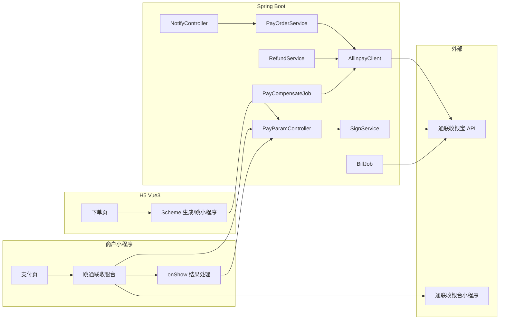
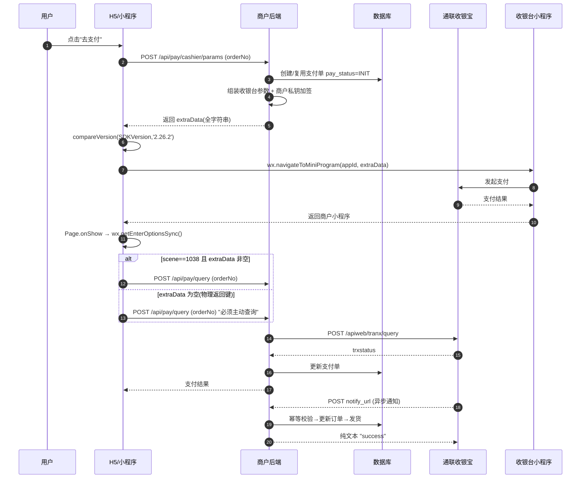
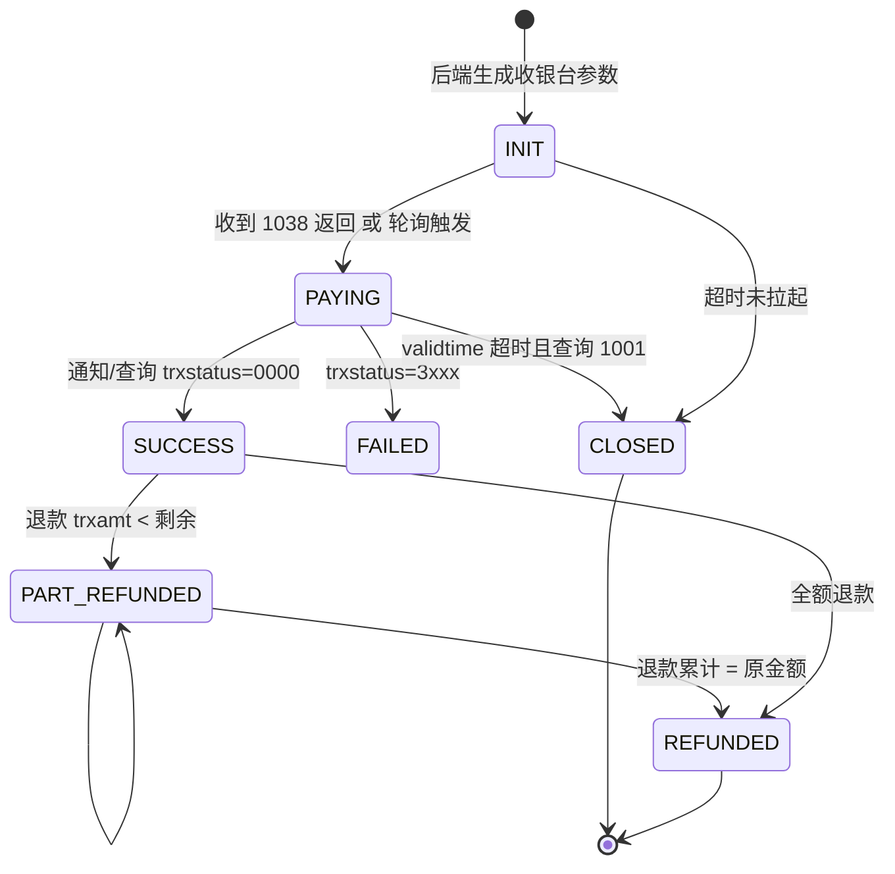

# 微信支付（收银台）对接开发文档

> 需求来源：`新建 文本文档.txt`（微信支付（收银台）/ 收银宝对接支持）
> 技术栈：后端 Java 17 + Spring Boot 3.x；前端 原生微信小程序 + H5(Vue3)
> 文档版本：v1.0 / 2026-11-17

---

## 目录

1. [方案总览](#1-方案总览)
2. [整体架构与时序](#2-整体架构与时序)
3. [对接前准备与配置](#3-对接前准备与配置)
4. [签名与验签规范](#4-签名与验签规范)
5. [后端开发](#5-后端开发)
6. [前端开发](#6-前端开发)
7. [内部 API 契约（前后端）](#7-内部-api-契约前后端)
8. [异常与边界场景](#8-异常与边界场景)
9. [测试联调用例](#9-测试联调用例)
10. [上线清单](#10-上线清单)
11. [待确认项与风险](#11-待确认项与风险)
12. [附录：状态码与字段](#12-附录状态码与字段)

---

## 1. 方案总览

### 1.1 业务目标

商户拥有 H5 商城与微信小程序，用户在这两类页面选购商品后，通过**微信浏览器或其他浏览器**发起微信支付。资金通道为**通联支付 · 收银宝**，收银台载体为**通联微信小程序收银台**（appId `wxef277996acc166c3`，原始 ID `gh_e64a1a89a0ad`）。

### 1.2 关键设计结论

| # | 结论 | 说明 |
|---|---|---|
| 1 | **下单不落远程调用** | 收银台模式下商户后端**不需要**调用通联下单接口拿 prepay_id，只需按《小程序收银台支付参数》组装字段并用**商户私钥签名**，返回给小程序前端。这是本方案与微信支付 JSAPI 直连最大的差异。 |
| 2 | **签名必须在后端完成** | 私钥不能下发到小程序/H5，因此前端跳转参数一律由后端 `/api/pay/cashier/params` 生成。 |
| 3 | **前端回调不可信** | `extraData` 只用于 UI 提示，订单终态一律以**异步通知 + 主动查询**为准。 |
| 4 | **物理返回键会丢结果** | 需求文档已明确该特性：场景值 `1038` + 来源 `wxef277996acc166c3` 但 `extraData` 为空时，必须走主动查询兜底。 |
| 5 | **通知验签要遍历全量参数** | 严禁按文档字段名逐个 `getParameter("key")`，收银宝后续新增字段会导致验签失败。 |
| 6 | **查询是必备能力而非可选** | 需求要求"建议接入主动查询"，本方案将其实现为**定时补偿任务 + 前端轮询接口**双通道。 |

### 1.3 系统边界

```
H5 商城(Vue3)  ─┐
               ├─→ 商户后端(Spring Boot) ─→ 通联收银宝 vsp.allinpay.com
微信小程序     ─┘        ↑
                         └── 异步通知 notify_url
```

涉及四组能力：收银台参数生成、交易结果通知、交易查询、交易退款；另加对账单下载（离线任务）。

---

## 2. 整体架构与时序

### 2.1 模块划分



### 2.2 支付主链路时序



### 2.3 支付单状态机



状态迁移**只允许**由 `PayOrderService#transit(orderNo, target, source)` 执行，内部用乐观锁（`version` 字段）保证并发下不出现 `SUCCESS → INIT` 之类的回退。

---

## 3. 对接前准备与配置

### 3.1 商务与资质（阻塞开发启动）

| 事项 | 责任方 | 说明 |
|---|---|---|
| 协议签署 + 入网材料提交 | 商户 → 通联客户经理 | 审核通过后客户经理同步**商户号 cusid** |
| 开通产品：网上收银-微信支付 | 客户经理 | 未开通无法收款 |
| 商户渠道认证 | 商户 | 找客户经理取**认证二维码**完成 |
| 对接参数共享（集团模式才需要） | 客户经理 | 需申请集团号并开通"对接参数共享" |
| **退款接口开通** | 客户经理 | ⚠️ 需求明确：**非代理商进件默认不开通退款**，必须提前确认 |
| CSV 对账单格式 | 客户经理 | 配置后仅对**后续日期**生效，历史不重生成 |
| 集团对账单 | 客户经理 | 同上，需提前配置 |

### 3.2 参数获取

按《平台参数设置指引》完成：`1.3.1 获取 appid 和私钥` → `1.3.3 配置微信支付参数` → `1.4 获取交易验签公钥`。

需要拿到 5 项：

| 参数 | 用途 | 保密 |
|---|---|---|
| `cusid` | 商户号（15 位） | 否 |
| `orgid` | 集团/代理商商户号（15 位） | 否，**单商户模式不上送** |
| `appid` | 应用 ID（8 位），每个商户号对应一个 | 否 |
| 商户 RSA 私钥 | 请求/参数加签 | **是** |
| 通联验签公钥 | 响应/通知验签 | 否 |

### 3.3 模式判定（写代码前必须先定）

| 模式 | 上送字段 | 加签密钥 | 备注 |
|---|---|---|---|
| 集团模式 | `orgid`=集团号、`appid`=集团 appid、`cusid`=**子商户号** | 集团号私钥 | 只维护一套密钥；需开通对接参数共享 |
| 单商户模式 | 不上送 `orgid` | 本商户私钥 | 需求说明：**商户号默认是单商户模式** |

### 3.4 配置文件

```yaml
# application.yml
allinpay:
  env: PROD                              # TEST -> syb-test.allinpay.com
  base-url: https://vsp.allinpay.com
  cus-base-url: https://cus.allinpay.com  # 对账单
  signtype: RSA                          # RSA | SM2
  merchant:
    cusid: ${ALIPAY_CUSID}
    appid: ${ALIPAY_APPID}
    orgid: ${ALIPAY_ORGID:}              # 单商户模式留空
    private-key: ${ALLINPAY_PRIVATE_KEY} # PKCS#8 Base64，禁止入库/入仓
    allinpay-public-key: ${ALLINPAY_PUBLIC_KEY}
  cashier:
    mini-app-id: wxef277996acc166c3      # 通联收银台小程序
    paytype: W06                         # 微信小程序 W06 / 支付宝小程序 A02
    version: "12"                        # 收银台参数版本号，默认返回 12
    api-version: "11"                    # tranx/query、tranx/refund 默认填 11
    isdirectpay: "1"                     # 跳收银台后默认帮用户点击支付下单
    valid-time-minutes: 15
    notify-url: https://pay.example.com/api/pay/allinpay/notify
    scheme-host: https://pay.example.com # H5 静态网站云开发校验域名
```

> 私钥通过环境变量 / KMS 注入。**任何情况下不得写入代码、配置仓库、日志。**

---

## 4. 签名与验签规范

### 4.1 待签名串构造（通联官方规则）

1. 取**除 `sign` 外的所有非空字段**（空字符串、null 一律剔除，不参与签名）；
2. 按字段名 **ASCII 码升序**排序；
3. 以 `key1=value1&key2=value2` 拼接（**值不做 URL 编码**，**不拼接 appkey 尾缀**）；
4. RSA：`SHA1WithRSA`，商户私钥签名，结果 Base64；验签用通联公钥。
5. SM2：`SM3WithSM2`，签名时 `userId = appid`。

示例（官方文档给出的样本）：

```
string = "appid=00000051&cusid=990581007426001&randomstr=82712208&signtype=RSA&trxid=112094120001088317&version=11"
sign   = SybUtil.rsaSign(string, cusRsaPrivateKey, "utf-8")
```

> 生产建议**直接复用通联官方 Java demo 的 `SybUtil.unionSign` / `SybUtil.validSign`**，自研实现只在单测比对通过后才上线——排序、空值、编码任一处偏差都会表现为难以排查的验签失败。

### 4.2 实现

```java
public final class AllinpaySigner {

    private static final String SIGN_FIELD = "sign";

    /** 构造待签名串：剔除空值与 sign，按 ASCII 升序，key=value& 拼接 */
    public static String buildSignContent(Map<String, String> params) {
        return params.entrySet().stream()
                .filter(e -> !SIGN_FIELD.equals(e.getKey()))
                .filter(e -> StringUtils.hasText(e.getValue()))
                .sorted(Map.Entry.comparingByKey())
                .map(e -> e.getKey() + "=" + e.getValue())
                .collect(Collectors.joining("&"));
    }

    /** 商户私钥加签（请求方向 / 收银台参数方向） */
    public static String sign(Map<String, String> params, String privateKeyPkcs8, String signType) {
        String content = buildSignContent(params);
        return switch (signType) {
            case "RSA" -> RsaUtil.signBySha1WithRsa(content, privateKeyPkcs8, StandardCharsets.UTF_8);
            case "SM2" -> SmUtil.signSM3SM2RetBase64(
                    SmUtil.privKeySM2FromBase64Str(privateKeyPkcs8), null, content.getBytes(StandardCharsets.UTF_8));
            default -> throw new IllegalArgumentException("unsupported signtype: " + signType);
        };
    }

    /** 通联公钥验签（响应方向 / 通知方向） */
    public static boolean verify(Map<String, String> params, String publicKeyX509, String signType) {
        String sign = params.get(SIGN_FIELD);
        if (!StringUtils.hasText(sign)) {
            return false;
        }
        String content = buildSignContent(params);
        return "RSA".equals(signType)
                ? RsaUtil.verifyBySha1WithRsa(content, publicKeyX509, sign, StandardCharsets.UTF_8)
                : SmUtil.verifySM3SM2(publicKeyX509, null, content.getBytes(StandardCharsets.UTF_8), sign);
    }
}
```

`signtype` 为空时按 **MD5** 处理（通知字段说明），若配置为 RSA 则以上逻辑统一走 RSA；对空值需回落到与下单一致的算法，避免"下单 RSA、通知按 MD5 验"的错配。

### 4.3 编码陷阱

- 通知的**每个字段都做了 UTF-8 UrlEncode**。Tomcat/IIS 等容器接收 form 表单会自动解一次码，**无需再 decode**；若自己读 InputStream 解析 body，必须手动 `URLDecoder.decode(v, "UTF-8")`。
- Spring Boot 需显式声明请求编码，否则 `trxreserved`（含中文/加号）验签必失败：

```yaml
# application.yml
server:
  servlet:
    encoding: { charset: UTF-8, force: true }
```

- 值中含 `+` 时，容器解码规则差异最容易出错，联调阶段务必用含中文商品名的用例覆盖。

---

## 5. 后端开发

### 5.1 包结构

```
com.example.pay
├── config/AllinpayProperties.java
├── cashier/
│   ├── CashierParamController.java     // 给前端产出跳转参数
│   ├── CashierParamService.java
│   └── dto/CashierExtraData.java
├── notify/AllinpayNotifyController.java
├── channel/
│   ├── AllinpayClient.java             // tranx/query, tranx/refund, 对账单
│   └── AllinpayResponse.java
├── order/
│   ├── PayOrder.java  PayOrderRepository.java
│   ├── PayOrderService.java            // 状态机 + 幂等
│   └── RefundOrderService.java
├── security/AllinpaySigner.java
└── job/
    ├── PayQueryCompensateJob.java      // 通知丢失兜底
    └── DailyBillJob.java               // D+1 对账
```

### 5.2 收银台参数生成

**《小程序收银台支付参数》字段表**（即 `extraData` 内容）：

| 字段 | 类型 | 必填 | 说明 |
|---|---|---|---|
| `cusid` | String | 是 | 实际交易商户号 |
| `orgid` | String | 否 | 集团商户号（集团模式才上送） |
| `appid` | String | 是 | 应用 ID |
| `innerappid` | String | 是 | innerappid |
| `version` | String | 是 | 版本号，默认 `12` |
| `trxamt` | String | 是 | 订单金额，**单位分** |
| `reqsn` | String | 是 | 商户订单号（渠道请求流水号） |
| `notify_url` | String | 是 | 异步通知地址 |
| `body` | String | 否 | 订单标题，同交易请求 `goodsName` |
| `remark` | String | 否 | 订单备注，同交易请求 `summay` |
| `validtime` | String | 否 | 有效时间 |
| `limit_pay` | String | 否 | 支付限制，如 `no_credit` |
| `paytype` | String | 是 | 微信小程序 `W06`；支付宝小程序 `A02` |
| `multipay` | String | 否 | 支持多渠道支付 |
| `isdirectpay` | String | 否 | 是否直接支付，上送 `1` 跳到收银台后默认帮用户点击支付下单 |
| `subbranch` | String | 否 | 通联系统门店号 |
| `ishideshare` | String | 否 | 是否禁止分享 |
| `idno` / `truename` | String | 否 | 证件号 / 付款人真实姓名 |
| `fqnum` | String | 否 | 支付宝分期 |
| `randomstr` | String | 是 | 随机字符串（≤32） |
| `signtype` | String | 是 | `RSA` / `SM2` |
| `sign` | String | 是 | 签名 |

```java
@Service
@RequiredArgsConstructor
public class CashierParamService {

    private final AllinpayProperties props;
    private final PayOrderRepository orderRepo;
    private final PayOrderService payOrderService;

    public CashierExtraData create(String bizOrderNo) {
        BizOrder biz = bizOrderService.loadForPay(bizOrderNo);   // 校验归属/可支付
        PayOrder order = payOrderService.createOrReuse(biz);      // 幂等：同单复用 reqsn

        Map<String, String> p = new LinkedHashMap<>();
        p.put("cusid", props.getCusid());
        if (StringUtils.hasText(props.getOrgid())) {
            p.put("orgid", props.getOrgid());                     // 仅集团模式
        }
        p.put("appid", props.getAppid());
        p.put("innerappid", props.getAppid());
        p.put("version", props.getVersion());                     // "12"
        p.put("reqsn", order.getReqsn());
        p.put("trxamt", String.valueOf(order.getAmountFen()));    // 分
        p.put("notify_url", props.getNotifyUrl());
        p.put("body", order.getSubject());
        p.put("remark", order.getReqsn());
        p.put("validtime", String.valueOf(props.getValidTimeMinutes()));
        p.put("limit_pay", "no_credit");
        p.put("paytype", props.getPaytype());                     // W06
        p.put("isdirectpay", props.getIsdirectpay());             // "1"
        p.put("randomstr", RandomStrUtil.next(32));
        p.put("signtype", props.getSigntype());
        p.put("sign", AllinpaySigner.sign(p, props.getPrivateKey(), props.getSigntype()));

        payOrderService.markPaying(order.getReqsn());
        return CashierExtraData.from(p);   // 全字段转 String
    }
}
```

> `innerappid` 与 `appid` 的取值以客户经理下发为准：多数商户两者相同，个别存在独立 innerappid。若下发的是独立值，`sign` 用**商户私钥**、`appid` 用**平台分配 appid**，两者不要混用。

### 5.3 异步通知处理

需求与官方约束汇总：

| 约束 | 值 |
|---|---|
| 方法 | POST，`application/x-www-form-urlencoded` |
| 通知超时 | 默认 3s，超时或未正确响应 `success` 视为失败 |
| 重发次数 | 8 次 |
| 重发频率 | `15s/15s/5m/10m/15m/20m/25m/30m`，总计 105m30s |
| 应答 | 纯文本 `success`（非 JSON、无引号、无 BOM、HTTP 200） |
| 字段取值 | 必须遍历全量非空参数，禁止逐个 `getParameter("key")` |

> ⚠️ **需求文档原文写的是"通知频率为 15s/15s/5m/10m/15m - 总计 30m30s"**，与通联现行文档（8 次 / 105m30s）不一致。补偿任务的超时判定按 **30 分钟以上未收到即触发查询**设计即可覆盖两种口径，此项列入 §11 待确认。

**通知核心字段**（`cusorderid` 才是下单时的 `reqsn`，注意不是 `reqsn`）：

| 字段 | 说明 |
|---|---|
| `appid` / `cusid` | 应用 ID / 商户编号 |
| `cusorderid` | **业务流水 = 统一下单的 reqsn** |
| `trxid` | 收银宝交易单号 |
| `chnltrxid` | 渠道流水号（微信平台订单号） |
| `trxcode` | 交易类型 |
| `initamt` / `trxamt` | 原始下单金额 / 交易金额（分） |
| `trxdate` / `paytime` | 请求日期 yyyymmdd / 完成时间 yyyymmddhhmmss |
| `trxstatus` | 交易结果码，`0000` 为成功 |
| `acct` / `tlopenid` | 支付平台用户标识 / 通联渠道侧 OPENID |
| `cmid` / `chnlid` / `chnldata` | 渠道子商户号 / 渠道号 / 渠道营销信息 |
| `fee` / `feecycle` / `feefq` | 手续费 / 结算周期 / 分期贴息手续费 |
| `trxreserved` | 业务关联内容（易含中文，验签重点） |
| `srctrxid` | 原交易流水（冲正/撤销时非空） |
| `mktresult` | 基础营销权益抵扣明细（JSON 串） |
| `signtype` / `sign` | 签名类型 / 校验码 |

```java
@RestController
@RequestMapping("/api/pay/allinpay")
@RequiredArgsConstructor
@Slf4j
public class AllinpayNotifyController {

    private final PayOrderService payOrderService;
    private final NotifyLogRepository notifyLogRepo;

    @PostMapping(value = "/notify", produces = MediaType.TEXT_PLAIN_VALUE)
    public ResponseEntity<String> notify(HttpServletRequest request) {

        // ① 全量取参：兼容收银宝后续新增字段，逐个 getParameter 会验签失败
        Map<String, String> params = new TreeMap<>();
        for (String name : Collections.list(request.getParameterNames())) {
            String[] vs = request.getParameterValues(name);
            String v = (vs == null || vs.length == 0) ? null : vs[0];
            if (StringUtils.hasText(v)) {
                params.put(name, v);
            }
        }

        String reqsn = params.get("cusorderid");
        notifyLogRepo.save(NotifyLog.received(reqsn, params));   // 原文留档，便于排障

        // ② 验签（容器已解码，勿再 decode）
        if (!AllinpaySigner.verify(params, publicKey, params.get("signtype"))) {
            log.warn("notify sign verify failed, reqsn={}", reqsn);
            return ResponseEntity.status(HttpStatus.UNAUTHORIZED).body("fail");
        }

        // ③ 金额与商户号二次校验，防参数篡改
        if (!props.getCusid().equals(params.get("cusid"))) {
            return ResponseEntity.ok("fail");
        }

        // ④ 幂等 + 状态机迁移（内部：SELECT ... FOR UPDATE 或乐观锁 + 唯一键）
        payOrderService.handleNotify(
                reqsn,
                params.get("trxid"),
                params.get("trxstatus"),
                Long.parseLong(params.get("trxamt")),
                params.get("paytime"),
                params.get("chnltrxid"));

        // ⑤ 非终态（2000/2008/空）也要回 success，让通联停止重发，交给补偿任务查询
        return ResponseEntity.ok("success");
    }
}
```

幂等要点：

- 唯一键 `(reqsn, trxid, trxstatus)`；重复通知直接返回 `success`，**不要**重复发货。
- `trxstatus=0000` 之外的通知**只记录不迁移终态**，避免把 `2000 处理中` 当失败处理。
- 业务动作（发货/解锁库存）与状态写入**同事务**或用本地消息表，禁止先发消息后改状态。
- 通知接口不做鉴权拦截（通联不带签名头），但必须**关闭全局 CSRF / 登录校验**并单独放行。

### 5.4 交易查询

| 项 | 值 |
|---|---|
| 生产 | `POST https://vsp.allinpay.com/apiweb/tranx/query` |
| 测试 | `POST https://syb-test.allinpay.com/apiweb/tranx/query` |

请求：`cusid`、`appid`、`version`(默认 11)、`reqsn`、`trxid`（**二者必填其一，同时拥有优先 `trxid`**）、`orgid`（集团模式必填）、`randomstr`、`signtype`、`sign`。

响应关键字段：`retcode`(通信标识，非交易结果)、`trxid`、`chnltrxid`、`reqsn`、`trxcode`、`trxamt`、`trxstatus`(**为空表示交易处理中，尚未完成**)、`acct`、`fintime`、`initamt`、`fee`、`chnldata`、`sign`。

需求规定的四类必须查询场景，全部实现为代码路径：

1. 商户后台/网络/服务器异常导致最终未收到通知 → `PayQueryCompensateJob`；
2. 调用支付接口后返回系统错误或未知交易状态 → 参数生成/查询失败分支；
3. 统一扫码接口后 `trxstatus=2000` → 状态机 `PAYING` 且立即重试查询；
4. 调用关单或撤销前需确认支付状态 → `CloseService` 强制先查后关。

```java
@Component
@RequiredArgsConstructor
public class AllinpayClient {

    private final RestClient restClient;
    private final AllinpayProperties props;

    public QueryResult query(String reqsn, String trxid) {
        Map<String, String> p = new LinkedHashMap<>();
        putIfHasText(p, "orgid", props.getOrgid());
        p.put("cusid", props.getCusid());
        p.put("appid", props.getAppid());
        p.put("version", props.getApiVersion());        // "11"
        p.put("randomstr", RandomStrUtil.next(32));
        p.put("signtype", props.getSigntype());
        if (StringUtils.hasText(trxid)) {
            p.put("trxid", trxid);                      // 优先 trxid
        } else {
            p.put("reqsn", reqsn);
        }
        p.put("sign", AllinpaySigner.sign(p, props.getPrivateKey(), props.getSigntype()));

        Map<String, String> resp = restClient.post()
                .uri(props.getBaseUrl() + "/apiweb/tranx/query")
                .contentType(MediaType.APPLICATION_FORM_URLENCODED)
                .body(formBody(p))
                .retrieve().body(MAP_TYPE);

        verifyOrThrow(resp);                            // retcode=FAIL 直接抛异常
        return QueryResult.of(resp);                    // 空 trxstatus => PROCESSING
    }
}
```

```java
/** 通知丢失补偿：PAYING 超过 30s 起查，退避 30s/1m/5m/15m/30m，最长 2h 转人工 */
@Scheduled(fixedDelay = 15_000)
public void compensate() {
    List<PayOrder> stale = orderRepo.findPayableForQuery(
            PayStatus.PAYING, Instant.now().minusSeconds(30), PageRequest.of(0, 200));
    for (PayOrder o : stale) {
        try {
            QueryResult r = allinpayClient.query(o.getReqsn(), o.getTrxid());
            payOrderService.transit(o.getReqsn(), r.getStatus(), "QUERY");
        } catch (AllinpayBizException e) {
            if ("1001".equals(e.getTrxstatus())) {         // 交易不存在
                payOrderService.closeIfExpired(o);
            }
            orderRepo.increaseQueryAttempt(o.getReqsn());
        }
    }
}
```

### 5.5 交易退款

| 项 | 值 |
|---|---|
| 生产 | `POST https://vsp.allinpay.com/apiweb/tranx/refund` |
| 测试 | `POST https://syb-test.allinpay.com/apiweb/tranx/refund` |

需求 + 官方规则合并清单（**全部要写进校验或注释**）：

- `oldreqsn` 与 `oldtrxid` 必填其一；同时拥有时**优先 `oldtrxid`**。
- 用 `oldreqsn` 关联时，必须保证 `reqsn`（退款流水）≠ `oldreqsn` 且全局唯一，否则多次部分退款会关联错订单导致失败。
- 支持部分退款与全额退款，部分退款可多次，**累计不超过原订单金额**。
- 微信侧限制：单个支付订单**部分退款次数 ≤ 50 次**。
- **同一笔订单多次退款请求需相隔 1 分钟**。
- **交易时间超过 360 天的订单无法提交退款**。
- 建议退款在交易完成后**间隔至少 5 分钟**再发起，避免状态同步不及时导致失败。
- 退款基本实时返回结果，网络波动会返回"进行中"，可主动查询或上送 `notify_url`。
- 云闪付（银联扫码）含单品优惠交易**只能整单退款**，不支持部分退款。
- `reason`（退款理由，微信账单显示）**仅微信交易允许上送**。
- ⚠️ 非代理商进件**退款接口默认不开通**，上线前必须与客户经理确认退货功能。

```java
public RefundResult refund(String originReqsn, long refundFen, String reason) {
    PayOrder origin = orderRepo.mustFind(originReqsn);

    // 前置校验：把渠道限制前移成业务异常，而不是等通联返回 3xxx
    if (origin.getPayTime().plusDays(360).isBefore(Instant.now())) {
        throw new BizException("REFUND_EXPIRED", "交易超过 360 天不可退款");
    }
    if (Duration.between(origin.getLastRefundTime(), Instant.now()).toMinutes() < 1) {
        throw new BizException("REFUND_TOO_FREQUENT", "同一订单多次退款需相隔 1 分钟");
    }
    if (origin.getRefundCount() >= 50) {
        throw new BizException("REFUND_LIMIT", "微信侧部分退款次数不得超过 50 次");
    }
    long rest = origin.getAmountFen() - origin.getRefundedFen();
    if (refundFen <= 0 || refundFen > rest) {
        throw new BizException("REFUND_AMOUNT_INVALID", "累计退款不得超过原订单金额");
    }

    String reqsn = refundSeq.next();                       // 与 oldreqsn 不同且全局唯一
    Map<String, String> p = baseParams(props.getApiVersion());
    p.put("trxamt", String.valueOf(refundFen));
    p.put("reqsn", reqsn);
    if (StringUtils.hasText(origin.getTrxid())) {
        p.put("oldtrxid", origin.getTrxid());              // 优先 oldtrxid
    } else {
        p.put("oldreqsn", origin.getReqsn());
    }
    p.put("reason", reason);                               // 仅微信交易
    p.put("notify_url", props.getRefundNotifyUrl());       // https 仅支持 443
    p.put("sign", AllinpaySigner.sign(p, props.getPrivateKey(), props.getSigntype()));

    RefundResult r = allinpayClient.refund(p);
    refundOrderService.record(reqsn, originReqsn, refundFen, r);
    return r;   // 处理中 → 由查询任务收敛
}
```

> `notify_url` 必须为**直接可访问**的地址，不能携带 query 参数；使用 https 时**只支持默认 443 端口**。

### 5.6 对账

| 项 | 值 |
|---|---|
| 接口 | `获取对账单` → `cusapi/trxfile/get`（生产域名 `https://cus.allinpay.com`，测试 `https://syb-test.allinpay.com/vsppcusapi`） |
| 可下载时间 | **D+1 凌晨 5:00 之后** |
| 格式 | 默认 excel；数据过多时自动转 csv；需 CSV 请联系客户经理配置，**仅对后续日期生效** |
| 集团模式 | `orgid` 与 `cusid` **均上送集团号**，可获取所有子商户号对账文件（同一表格），需提前配置集团对账单 |

```java
@Scheduled(cron = "0 30 6 * * *")   // 6:30，留足 5:00 之后余量
public void pullBill() {
    String day = LocalDate.now().minusDays(1).format(BASIC_ISO_DATE);
    BillFile f = allinpayBillClient.download(day, props.isGroupMode());
    billReconcileService.reconcile(f, day);   // 差异写入 recon_diff，人工处理
}
```

> 对账地址与请求字段在通联侧分属"代理商/商户"两套入口，**接入前请以最新《获取对账单》文档与 demo 为准**核对参数（此项列入 §11）。

### 5.7 数据模型

```sql
CREATE TABLE pay_order (
  id            BIGINT PRIMARY KEY AUTO_INCREMENT,
  biz_order_no  VARCHAR(64)  NOT NULL,
  reqsn         VARCHAR(50)  NOT NULL,          -- 上送收银台的商户订单号
  cusid         VARCHAR(15)  NOT NULL,
  orgid         VARCHAR(15),
  amount_fen    BIGINT       NOT NULL,
  status        VARCHAR(16)  NOT NULL,          -- INIT/PAYING/SUCCESS/FAILED/CLOSED/PART_REFUNDED/REFUNDED
  trxid         VARCHAR(50),                    -- 收银宝流水
  chnltrxid     VARCHAR(64),                    -- 微信流水
  pay_time      DATETIME,
  expire_time   DATETIME     NOT NULL,          -- validtime
  refund_fen    BIGINT       NOT NULL DEFAULT 0,
  refund_count  INT          NOT NULL DEFAULT 0,
  last_refund_time DATETIME,
  query_attempt INT          NOT NULL DEFAULT 0,
  notify_time   DATETIME,
  source        VARCHAR(16),                    -- NOTIFY/QUERY/MANUAL
  version       INT          NOT NULL DEFAULT 0,-- 乐观锁
  create_time   DATETIME     NOT NULL,
  update_time   DATETIME     NOT NULL,
  UNIQUE KEY uk_reqsn (reqsn),
  KEY idx_status_expire (status, expire_time)
);

CREATE TABLE refund_order (
  id BIGINT PRIMARY KEY AUTO_INCREMENT,
  reqsn     VARCHAR(50) NOT NULL,      -- 退款流水，全局唯一且 != oldreqsn
  old_reqsn VARCHAR(50) NOT NULL,
  old_trxid VARCHAR(50),
  refund_fen BIGINT     NOT NULL,
  status    VARCHAR(16) NOT NULL,
  trxid     VARCHAR(50),
  create_time DATETIME  NOT NULL,
  UNIQUE KEY uk_reqsn (reqsn)
);

CREATE TABLE pay_notify_log (
  id BIGINT PRIMARY KEY AUTO_INCREMENT,
  reqsn VARCHAR(50), trxid VARCHAR(50), trxstatus VARCHAR(4),
  raw_body MEDIUMTEXT NOT NULL,        -- 全量原文，排障用
  verify_pass TINYINT NOT NULL,
  create_time DATETIME NOT NULL,
  KEY idx_reqsn (reqsn)
);
```

`pay_notify_log` 保留原始 body，是排查"验签失败/中文字段/重复通知"最有效的手段；上线必须开。

---

## 6. 前端开发

### 6.1 H5（Vue3）拉起小程序

适用场景：支持在微信浏览器或其他浏览器发起微信支付；H5 侧**不直接调起支付**，而是拉起商户小程序，再由商户小程序跳转通联收银台。需求给出两种方式：

**方式 A：微信静态网站云开发能力（H5 跳小程序）** — 仅限微信内置浏览器，需完成公众号**JS接口安全域名 + 业务域名**配置与静态网站校验文件部署。

```html
<!-- open-launch-weapp 组件，path 指向商户小程序支付页 -->
<script type="text/javascript" src="https://res.wx.qq.com/open/js/jweixin-1.6.0.js"></script>
<script type="text/javascript">
  wx.config({
    debug: false, appId: '<%= wxMpAppId %>', timestamp: <%= ts %>,
    nonceStr: '<%= nonce %>',
    signature: '<%= signature %>',
    jsApiList: ['openAddress']
  });
  wx.ready(() => {
    const btn = document.getElementById('launch-btn');
    btn.addEventListener('launch', () => {});
    btn.addEventListener('fail', e => console.log('拉起小程序失败', e.detail));
  });
</script>

<button id="pay">去支付</button>
<wx-open-launch-weapp id="launch-btn" appid="<%= 商户小程序原始ID %>"
      path="pages/pay/pay.html?orderNo={{ orderNo }}">
  <script type="text/wxtag-template">
    <style>.btn{padding:12px;background:#07c160;color:#fff;border-radius:4px}</style>
    <div class="btn">打开小程序支付</div>
  </script>
</wx-open-launch-weapp>
```

> `jweixin-1.6.0.js` 由微信官方域名 `res.wx.qq.com` 提供，微信侧不发布固定 SRI 摘要，无法加 `integrity`。安全前提是：**只用 https 从官方域名加载、不镜像到自建 CDN、不做 document.write 动态注入**，并开启 CSP `script-src https://res.wx.qq.com 'unsafe-inline'`（`wx-open-launch-weapp` 内的 `text/wxtag-template` 必须允许内联脚本，否则组件不渲染）。签名参数 `timestamp/nonceStr/signature` 由后端 `jsapi_ticket` 生成，**ticket 与私钥同样不得下发前端**。

**方式 B：获取小程序 URL Scheme** — 适用于外部浏览器（Safari/Chrome/其他 App WebView）。后端调微信服务端接口 `POST https://api.weixin.qq.com/wxa/generatescheme`（需 `access_token`，仅非个人主体、已发布小程序可生成）生成 scheme 后下发，接口契约与限频细节见《前端开发文档-H5拉起小程序收银台支付.md》：

```ts
// src/api/pay.ts
export async function goPay(orderNo: string) {
  const { schemeUrl, wxInstalled } = await http.post('/api/pay/h5-scheme', { orderNo });
  const inWeChat = /MicroMessenger/i.test(navigator.userAgent);
  if (inWeChat) {
    // 走方式 A，由 wx-open-launch-weapp 组件拉起
    showLaunchWeappLayer(orderNo);
    return;
  }
  window.location.href = schemeUrl;   // 外部浏览器直接跳 scheme
  // 埋点：记录跳转时间，回到 H5 后触发轮询
  localStorage.setItem('pay_pending_order', orderNo);
}
```

```ts
// src/composables/usePayResult.ts —— 回到 H5 后只认后端结果
export function usePayResult(orderNo: Ref<string>) {
  const status = ref<'PAYING' | 'SUCCESS' | 'FAILED'>('PAYING');
  let timer: number;
  const poll = async () => {
    const r = await http.post('/api/pay/query', { orderNo });   // 后端转发 tranx/query
    status.value = r.status;
    if (r.status !== 'PAYING') clearInterval(timer);
  };
  onMounted(() => { if (status.value === 'PAYING') timer = setInterval(poll, 3000); });
  onUnmounted(() => clearInterval(timer));
  return status;
}
```

> URL Scheme **有有效期且不可分享、不可在微信内打开**；不要把 scheme 落库长期复用，每次下单现取。

### 6.2 小程序跳转通联收银台

涉及官方方法：`wx.navigateToMiniProgram`、`wx.openEmbeddedMiniProgram`（半屏，需申请 + 基础库 ≥ 2.26.2）、`compareVersion`。

```js
// utils/allinpay.js
const CASHIER_APPID = 'wxef277996acc166c3';

/** 官方 compareVersion 实现 */
function compareVersion(v1, v2) {
  const s1 = v1.split('.');
  const s2 = v2.split('.');
  const len = Math.max(s1.length, s2.length);
  while (s1.length < len) s1.push('0');
  while (s2.length < len) s2.push('0');
  for (let i = 0; i < len; i++) {
    const n1 = parseInt(s1[i], 10);
    const n2 = parseInt(s2[i], 10);
    if (n1 > n2) return 1;
    if (n1 < n2) return -1;
  }
  return 0;
}

/**
 * extraData 中所有参数值均需使用字符串类型（需求明确要求）
 * 后端 /api/pay/cashier/params 已返回 string 化的全量字段
 */
function toStrData(params) {
  const out = {};
  Object.keys(params).forEach(k => {
    if (params[k] !== null && params[k] !== undefined) out[k] = String(params[k]);
  });
  return out;
}

export async function jumpToCashier(orderNo) {
  const params = await request.post('/api/pay/cashier/params', { orderNo });
  const extraData = toStrData(params);
  wx.setStorageSync('pay_jump_flag', { orderNo, ts: Date.now() });   // 物理返回兜底

  const sdkVersion = wx.getAppBaseInfo().SDKVersion;
  const useEmbedded =
    compareVersion(sdkVersion, '2.26.2') >= 0 && getApp().globalData.enableHalfScreen;

  return new Promise((resolve, reject) => {
    const opts = { appId: CASHIER_APPID, extraData, envVersion: 'release' };
    const handler = { success: resolve, fail: reject };
    if (useEmbedded) {
      wx.openEmbeddedMiniProgram({ ...opts, ...handler });   // 半屏：需提前申请
    } else {
      wx.navigateToMiniProgram({ ...opts, ...handler });     // 未申请半屏时直接用这个
    }
  });
}
```

```js
// pages/pay/pay.js
import { jumpToCashier } from '../../utils/allinpay';

Page({
  data: { orderNo: '', status: 'INIT' },

  onLoad(query) { this.setData({ orderNo: query.orderNo }); },

  onTapPay() {
    jumpToCashier(this.data.orderNo).catch(err => {
      // 用户在跳转确认弹窗点"取消" / 未申请半屏却调用 openEmbeddedMiniProgram
      wx.showToast({ title: '支付已取消', icon: 'none' });
      this.queryResult('JUMP_FAIL');
    });
  },

  /** 支付结果接收：Page.onShow + wx.getEnterOptionsSync() */
  onShow() {
    const options = wx.getEnterOptionsSync();
    if (options.scene === '1038' && options.referrerInfo?.appId === 'wxef277996acc166c3') {
      const extraData = options.referrerInfo.extraData;
      if (!extraData) {
        // 物理返回键 / 半屏右上角关闭 —— 微信小程序特性，代码无法处理
        // 必须自行查询订单支付结果
        this.queryResult('NO_CALLBACK');
        return;
      }
      if (extraData.code === 'success')      this.queryResult('FRONT_SUCCESS');
      else if (extraData.code === 'cancel')  this.setStatus('CANCEL_TIP');
      else                                   this.setStatus('FAIL', extraData.errmsg);
    }
  },

  /** 前端 extraData 只用于 UI，终态以服务端查询为准 */
  async queryResult(source) {
    const r = await request.post('/api/pay/query', {
      orderNo: this.data.orderNo, source
    });
    this.setStatus(r.status, r.errmsg);
    if (r.status === 'PAYING') setTimeout(() => this.queryResult('POLL'), 3000);
  }
});
```

### 6.3 前端硬性注意事项

| # | 注意 | 原因 |
|---|---|---|
| 1 | `extraData` 全部值 **String 化** | 需求原文要求，数字类型会导致收银台侧解析/验签不一致 |
| 2 | 未申请半屏 **不要**用 `wx.openEmbeddedMiniProgram` | 会直接 fail |
| 3 | 用 `compareVersion` 做基础库版本分支 | 半屏需 ≥ 2.26.2 |
| 4 | `scene` 比较用字符串 `'1038'` | `getEnterOptionsSync().scene` 类型跨版本不一致 |
| 5 | 同时校验 `referrerInfo.appId` | 只判 scene 会把其他来源小程序的返回误当收银台结果 |
| 6 | 结果页永远调后端查询 | `extraData.code` 不是终态依据 |
| 7 | 小程序须配置 **业务域名** `https://pay.example.com` | 否则 request 被拦截 |
| 8 | `path` 传参方式（APP 调起）字段一律 query 拼接 | 官方示例：`path=pages/orderDetail/orderDetail?cusid=...&sign=...` |

---

## 7. 内部 API 契约（前后端）

| 方法 | 路径 | 说明 |
|---|---|---|
| POST | `/api/pay/cashier/params` | 生成收银台跳转参数（已加签，全 String） |
| POST | `/api/pay/h5-scheme` | H5 获取小程序 URL Scheme |
| POST | `/api/pay/query` | 查询支付终态（后端转发 `tranx/query`，带缓存与频控） |
| POST | `/api/pay/allinpay/notify` | 交易结果异步通知（通联调用，应答 `success`） |
| POST | `/api/admin/refund` | 发起退款（运营后台） |
| POST | `/api/admin/refund/query` | 退款结果查询 |
| GET | `/api/admin/bill?date=` | 触发/下载对账单 |

`/api/pay/cashier/params`

```jsonc
// req
{ "orderNo": "B202611170001" }
// resp 200 —— 直接作为 wx.navigateToMiniProgram 的 extraData
{
  "cusid": "990581007426001",
  "appid": "00000051",
  "innerappid": "00000051",
  "version": "12",
  "reqsn": "P2026111700000001",
  "trxamt": "1",
  "notify_url": "https://pay.example.com/api/pay/allinpay/notify",
  "body": "商品标题",
  "remark": "P2026111700000001",
  "validtime": "15",
  "limit_pay": "no_credit",
  "paytype": "W06",
  "isdirectpay": "1",
  "randomstr": "82712208a1b2c3d4e5f60718293a4b5c",
  "signtype": "RSA",
  "sign": "ce6EAOj4rhoBMJM5MJCNG4qQ/CVMTWko...="
}
```

`/api/pay/query`

```jsonc
{ "orderNo": "B202611170001", "source": "NO_CALLBACK",
  "data": { "status": "SUCCESS", "trxid": "112094120001088317",
            "chnltrxid": "4200002xxxxx202611170001", "amountFen": 1,
            "payTime": "20261117103201" } }
```

错误码约定（前端文案映射）：`PAY_ORDER_NOT_PAYABLE`、`PAY_ORDER_EXPIRED`、`REFUND_EXPIRED`、`REFUND_TOO_FREQUENT`、`REFUND_LIMIT`、`REFUND_AMOUNT_INVALID`、`ALLINPAY_SIGN_VERIFY_FAIL`、`ALLINPAY_CHANNEL_ERROR`。

---

## 8. 异常与边界场景

| 场景 | 判定 | 处理 |
|---|---|---|
| 物理返回键/半屏右上角关闭退出 | `scene==1038` 且 `extraData` 为空 | 小程序调 `/api/pay/query`；后端补偿任务同步收敛 |
| 通知超时（>3s 未回 `success`） | 通联判定失败并重发 | 通知处理必须 <1s：验签 + 落库 + 状态迁移同步做，发货等动作走 MQ |
| 通知始终不达 | 30min 后仍无记录 | 补偿任务查询，`source=QUERY` |
| 通知重复投递 | 8 次重发 + 网络重试 | `(reqsn,trxid,trxstatus)` 唯一键去重 |
| 通知新增未知字段 | 验签失败 | 全量遍历取参（已在 §5.3 强制） |
| `trxstatus=2000/2008` 或为空 | 处理中 | 不迁移终态；10s 起退避重试 |
| `trxstatus=1001` 交易不存在 | 未支付 | `validtime` 内保持 `PAYING`，超时转 `CLOSED` |
| 用户重复点击支付 | 同一 `bizOrderNo` | `createOrReuse` 复用同一 `reqsn`，返回同一套参数 |
| `reqsn` 重复提交 | `3888 流水号重复` | 检查复用逻辑，禁止改 `reqsn` 重试 |
| 退款返回"进行中" | 网络波动 | 上送 `notify_url` + 查询收敛 |
| 部分退款超 50 次 / 未隔 1 分钟 / 超 360 天 | 提前校验拦截 | 返回业务错误码，文案明确 |
| 集团模式漏传 `orgid` | 加签与参数不一致 | 配置启动期校验：`groupMode` 必须有 `orgid` |
| 商户号未完成渠道认证 | 无法收款 | 上线清单强制项，加拨测 |
| HTTPS 通知端口非 443 | 通联不支持 | 网关只暴露 443；测试环境同样校验 |
| 通知 URL 带 query 参数 | "必须为直接可访问的 url" | 参数一律走 path/固定值 |

---

## 9. 测试联调用例

环境：测试 `https://syb-test.allinpay.com`，测试商户号 / 测试私钥由客户经理提供；生产上线前需申请切换。

| ID | 用例 | 步骤 | 预期 |
|---|---|---|---|
| T01 | 签名自洽 | 用官方 demo `SybUtil.unionSign` 与自研 `AllinpaySigner` 对同一参数集签名 | 两者结果一致 |
| T02 | 正常支付（全链路） | H5/小程序 → 收银台 → 微信支付成功 | 通知 `0000`，订单 `SUCCESS`，`trxid/chnltrxid` 落库 |
| T03 | 金额边界 | `trxamt=1`（分）、大额、含小数商品价 | 单位分不出现精度丢失 |
| T04 | 用户取消支付 | 收银台内点取消 | `extraData.code=cancel`，订单保持 `PAYING`，超时转 `CLOSED` |
| T05 | **物理返回键** | 支付中途按物理返回 | `extraData` 空，走查询兜底，状态正确 |
| T06 | **半屏右上角关闭** | `openEmbeddedMiniProgram` 后关半屏 | 同 T05 |
| T07 | 低版本基础库 | 基础库 < 2.26.2 且未申请半屏 | 走 `navigateToMiniProgram`，不报错 |
| T08 | 通知验签（含中文） | `trxreserved` 含中文与 `+` | 验签通过 |
| T09 | 通知**未知新增字段** | mock 一个文档外的 `newfield=x` | 仍验签通过（回归 §5.3） |
| T10 | 通知重复投递 | 同一通知连发 3 次 | 只处理一次，均回 `success` |
| T11 | 通知应答非 success | mock 返回 JSON | 通联 15s 后重发，补偿不重复发货 |
| T12 | 通知超时重发 | 处理耗时 >3s | 观察重发节奏 |
| T13 | 通知完全不达 | 防火墙屏蔽 notify | 补偿任务查询置 `SUCCESS` |
| T14 | 主动查询 `reqsn` | 只传 `reqsn` | 返回正确 |
| T15 | 主动查询 `trxid` | 同时有 `trxid`+`reqsn` | 走 `trxid`（优先级） |
| T16 | 查询处理中 | 支付中立即查 | `trxstatus=2000`/空 → `PAYING` |
| T17 | 全额退款 | 成功单退款 | `SUCCESS` → `REFUNDED` |
| T18 | 部分退款多次 | 分 3 次，累计 < 原额 | `PART_REFUNDED`，退款单号唯一 |
| T19 | **退款超累计上限** | 第 N 次超出 | 本地校验拦截，不发起渠道请求 |
| T20 | **1 分钟内二次退款** | 连续退款 | 拦截并提示 |
| T21 | **>360 天退款** | 构造历史单 | 拦截 `REFUND_EXPIRED` |
| T22 | 退款用 `oldreqsn` | 不传 `oldtrxid` | `reqsn != oldreqsn` 且唯一，退款成功 |
| T23 | 退款进行中 | mock 渠道延迟 | 查询收敛为终态 |
| T24 | 退款未开通 | 测试号未开退款 | 返回明确失败，不静默吞 |
| T25 | 集团模式 | `orgid`=集团号、`cusid`=子商户号、集团私钥加签 | 交易在子商户号入账 |
| T26 | 单商户模式 | 不上送 `orgid` | 正常 |
| T27 | `isdirectpay=1` | 跳收银台后自动点击支付 | 免二次点击 |
| T28 | 对账单 | D+1 6:30 拉取 | 文件可解析，差异表为空 |
| T29 | 对账差异 | 构造单边账 | 生成 `recon_diff` 记录并告警 |
| T30 | 并发 | 同单 10 并发请求支付参数 | `reqsn` 唯一，只一套参数 |
| T31 | 篡改金额 | mock 通知改 `trxamt` | 验签失败，拒绝 |
| T32 | 域名/证书 | notify 走 http、https 非 443 | 提前发现配置问题 |

**联调前自检**：先跑 T01 单测（对比 demo 签名）→ 再 T02 真机小额（1 分）→ 通了之后跑 T05/T06/T13 兜底链路。

---

## 10. 上线清单

```
[ ] 商务
  [ ] 已开通"网上收银-微信支付"
  [ ] 商户渠道认证完成（能收款）
  [ ] 退款功能已开通（非代理商进件默认不开通 ← 最易漏）
  [ ] 集团模式：已申请集团号 + 开通对接参数共享
  [ ] 需 CSV 对账单 / 集团对账单：已向客户经理申请（仅对后续日期生效）

[ ] 配置
  [ ] 生产 cusid / appid / (orgid) 已替换
  [ ] 商户私钥来自 KMS，未出现在代码与日志
  [ ] 通联验签公钥为生产版本
  [ ] notify_url：公网可达、HTTPS、443 端口、无 query 参数
  [ ] env: PROD，base-url 已切 vsp.allinpay.com

[ ] 微信侧
  [ ] 小程序 request 合法域名含支付域名
  [ ] 半屏 openEmbeddedMiniProgram 已申请（如使用）
  [ ] 静态网站云开发校验文件已部署 / JS 安全域名与业务域名已配置
  [ ] URL Scheme 生成接口配额与有效期确认

[ ] 稳定性
  [ ] pay_notify_log 原文留档已开启
  [ ] 补偿任务监控：PAYING 积压 > 50 告警
  [ ] 通知验签失败率 > 0 告警
  [ ] 退款失败、对账差异告警接入
  [ ] 灰度：先放 5% 流量 / 白名单商户号，观察 1 天

[ ] 回归
  [ ] T01、T02、T05、T13、T17 全部通过
  [ ] 生产小额（1 分）真实支付 + 退款闭环
  [ ] 回滚方案：支付开关（关闭后 H5/小程序隐藏"微信支付"入口）
```

---

## 11. 待确认项与风险

| # | 事项 | 建议 |
|---|---|---|
| 1 | **通知重发口径不一致**：需求文档写 `15s/15s/5m/10m/15m`（总计 30m30s），通联现行《交易结果通知》写 `15s/15s/5m/10m/15m/20m/25m/30m`（8 次，总计 105m30s） | 以**现行官方文档为准**；补偿任务阈值取 30min 可覆盖两种口径。向客户经理确认所属环境实际策略。 |
| 2 | `innerappid` 是否与 `appid` 同值 | 需求文档只提 appid；官方参数表两者均为必填。接入前向客户经理确认下发口径。 |
| 3 | 收银台参数 `version=12` 与 API `version=11` 并存 | 分别配置，勿混用（§3.4 已拆 `cashier.version` / `cashier.api-version`）。 |
| 4 | **是否存在后端预下单调用** | 本方案按需求原文"后端根据微信小程序收银台接口进行生成下单参数，并提供给小程序前端"理解为**本地加签、无远程下单**。若通联要求走《微信小程序收银台预消费》，需补 `unitorder/pay` 调用——以接口文档为最终依据。 |
| 5 | 获取对账单的地址分属 `cus.allinpay.com/cusapi/trxfile/get` 与 `vsp.allinpay.com/cusapi/...` 两套 | 上线前用官方《获取对账单》文档 + demo 核对；先用商户后台手工下载验证数据。 |
| 6 | 支付结果一致性 | 需求原文强调"不能保证通知最终能成功"。§5.4 补偿任务 + §6.3 前端查询是**必须**而非可选。 |
| 7 | 退款时效 | 官方建议交易完成后至少间隔 5 分钟再退款，前端"立即退款"按钮需加提示。 |

---

## 12. 附录：状态码与字段

### 12.1 `trxstatus` 交易返回码

| 码值 | 含义 | 是否终态 |
|---|---|---|
| `0000` | 交易成功 | 是 |
| `1001` | 交易不存在 | 否（可继续支付） |
| `2000` / `2008` | 交易处理中，请查询交易；实时交易建议每 10s 查询 | 否 |
| `3888` | 流水号重复 | 是 |
| `3889` | 交易控制失败（看 `errmsg`） | 是 |
| `3099` | 渠道商户错误 | 是 |
| `3014` | 交易金额小于应收手续费 | 是 |
| `3024` | 退款繁忙，请稍后再试 | 否 |
| `3031` | 校验实名信息失败 | 是 |
| `3088` | 交易未支付（区间内未成功支付，影响资金 24h 内差错退款） | 是 |
| `3089` | 撤销异常（影响资金 24h 内差错退款） | 是 |
| `3050` | 交易已被撤销 | 是 |
| `3008` | 商户余额不足 | 是 |
| `3045` / `3999` | 其他错误（看 `errmsg`） | 是 |

> **3 开头代表交易失败**；`retcode` 只是通信标识，`SUCCESS` 不代表交易成功，**交易结果一律看 `trxstatus`**。

### 12.2 接口清单

| 接口名称 | 地址 | 用途 |
|---|---|---|
| 微信小程序收银台 | 本地加签生成参数 | 拉起 `wxef277996acc166c3` |
| 交易查询 | `POST /apiweb/tranx/query` | 状态兜底 |
| 交易退款 | `POST /apiweb/tranx/refund` | 全额/部分退款 |
| 交易结果通知 | `notify_url`（商户侧） | 异步通知 |
| 获取对账单 | `cusapi/trxfile/get` | D+1 对账 |
| 统一撤销 / 统一交易关单 | `POST /apiweb/tranx/reverse`、关单接口 | 撤销/关单（调用前必须先查询确认状态） |

### 12.3 参考资料

- [9.1 微信小程序收银台支付调用说明](https://prodoc.allinpay.com/doc/1067/)
- [小程序收银台支付参数](https://prodoc.allinpay.com/doc/1380/)
- [2. 统一退款 API](https://prodoc.allinpay.com/doc/258/)
- [3. 统一查询 API](https://prodoc.allinpay.com/doc/2330/)
- [4. 交易结果通知](https://prodoc.allinpay.com/doc/2331/)
- [3. 收银宝接口安全规范](https://prodoc.allinpay.com/doc/2318/)
- [5. 收银宝交易返回码 trxstatus 说明](https://prodoc.allinpay.com/doc/2320/)
- [收银宝 API 接口指引](https://prodoc.allinpay.com/doc/2315/)
- [wx.navigateToMiniProgram 官方文档](https://developers.weixin.qq.com/miniprogram/dev/api/navigate/wx.navigateToMiniProgram.html)
